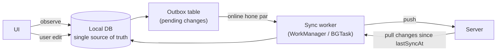

# 01. Mobile Deep: 3 saal waale se SDE-2 level par kya expect hota hai

> Interview mein sabse gehre sawaal yahin se aayenge, kyunki aapke resume par 3 saal mobile likha hai. "Kaise use karte hain" kaafi nahi; **"andar kaise kaam karta hai" aur "kab kya chunna"** aana chahiye.
> Neeche Section 1 sab stacks ke liye common hai. Section 2 mein apna stack padhiye (baaki skip).

---

## 1. Common mobile fundamentals (har stack)

### 1.1 Architecture

| Topic | Gehrai tak kya aana chahiye |
|---|---|
| **Layers** | UI → ViewModel/Presenter/Bloc → Repository → Data sources (remote API, local DB). Har layer ki zimmedari, aur dependency hamesha andar ki taraf |
| **Unidirectional data flow (UDF)** | State neeche jaata hai, events upar. Ek `UiState` object (loading / success / error / empty) vs bahut saare booleans: kyun ek object behtar hai |
| **MVVM vs MVI vs Clean** | MVVM: ViewModel state expose karta hai. MVI: intents → reducer → single state. Clean: use-cases ki extra layer. **Kab overkill hai** (chhota app) ye bhi bolna aana chahiye |
| **Repository pattern** | Single source of truth: UI hamesha **local DB** se padhe, network sirf DB update kare (offline-first ki neev) |
| **Dependency Injection** | Kyun (testing, swap implementations), constructor injection, scopes (singleton, screen-scoped) |
| **Modularization** | Feature modules, core modules, build time kam, team ownership; circular dependency se bachna |
| **Navigation** | Deep links, back stack, arguments pass karna, nested navigation, type-safe routes |

### 1.2 Networking

| Topic | Gehrai |
|---|---|
| HTTP client setup | Interceptors: auth header, logging, retry, timeout (connect / read / write alag) |
| **Token refresh (bahut poocha jaata hai)** | 5 requests ek saath 401 → sirf **ek** refresh call; baaki requests wait karein (mutex / lock / shared promise), refresh fail ho to logout. Refresh ke dauraan aayi nayi requests bhi queue |
| Retry | Exponential backoff + jitter; sirf idempotent requests (GET, PUT) ko retry; POST ke liye idempotency key |
| Pagination | Offset vs cursor; infinite scroll; "next page" ka loading/error state; duplicates se bachna |
| Caching | HTTP cache headers (ETag, Cache-Control) vs app-level cache; stale-while-revalidate |
| Error handling | Network error vs server error vs parse error; user ko kya dikhana |
| Large uploads | Multipart, chunked/resumable upload, progress, background mein upload, retry |
| Realtime | WebSocket vs SSE vs polling vs push; reconnect with backoff; app background mein jaaye to? |

### 1.3 Offline-first aur sync (senior level ka topic)



Aapko ye samjhana aana chahiye:
- **Outbox pattern:** har local change ek "pending" row; worker unhe order mein bhejta hai; success par delete.
- **Conflict resolution:** last-write-wins (timestamp), server-wins, field-level merge, ya user se poochna. Har ek ka nuksaan.
- **Delta sync:** `updatedAt > lastSyncAt` se sirf badle records; deletes ke liye "tombstone" (soft delete).
- **Client-generated IDs (UUID):** offline mein bana record server par duplicate na ho.
- **Idempotency:** same change do baar pahunch jaaye to server ek hi baar lagaye.

### 1.4 Performance

| Area | Kya napna | Kaise sudhaarna |
|---|---|---|
| **App startup** | Cold / warm / hot start; time to first frame, time to interactive | Lazy initialization, SDKs ko baad mein init, splash par kaam kam, (Android) Baseline Profiles |
| **UI jank** | Frame time (16 ms @60Hz, 8 ms @120Hz), dropped frames | Main thread par kaam kam, lists mein stable keys, image decode background mein, overdraw kam |
| **Memory** | Heap, leaks, bitmap size | Images downsample, caches limit, lifecycle ke saath listeners hatao |
| **Battery / network** | Wake-ups, requests ki ginti | Batching, background limits ka paalan, compression |
| **App size** | APK/AAB/IPA size | Code shrinking, resources optimize, dynamic features, unused deps hatao |

**Interview mein kahani:** "Maine X napa (tool), Y mila, Z kiya, number A se B hua." Isliye apne current app mein **ek** performance kaam zaroor karein.

### 1.5 Images

Downsampling (screen size ke hisaab se decode), memory + disk cache (LRU), placeholder, cancellation jab item scroll se bahar jaaye, progressive loading. Glide/Coil (Android), Kingfisher/SDWebImage (iOS), cached_network_image (Flutter), FastImage/expo-image (RN). **"Image loading library design karo"** ek common LLD sawaal hai.

### 1.6 Security

| Topic | Kya |
|---|---|
| Secure storage | Tokens Keystore/Keychain mein (EncryptedSharedPreferences, Keychain, flutter_secure_storage, react-native-keychain); kabhi plain prefs mein nahi |
| Certificate pinning | Kya hai, kab use, pin rotate kaise |
| API keys | App mein secret rakhna safe nahi; backend proxy |
| Root/jailbreak, tampering | Play Integrity / App Attest ka concept |
| Obfuscation | R8/ProGuard, Dart obfuscate; ye security nahi, sirf mushkil banana |
| Deep link security | Verified links (App Links / Universal Links), parameters validate |

### 1.7 Push notifications

Flow: app FCM/APNs token leta hai → backend ko bhejta hai → backend FCM/APNs ko message → device. Samjhiye:
- Notification message vs data message; foreground / background / killed state mein kya hota hai.
- Token refresh, multiple devices per user, logout par token hatana.
- Notification tap se deep link par sahi screen.
- Android notification channels, iOS permission flow, silent push ki limits.

### 1.8 Background work

Android: WorkManager (constraints, retries, unique work), foreground services ki rules. iOS: BGTaskScheduler (app refresh, processing), background URLSession. Flutter/RN: workmanager / background fetch plugins ki limits. **OS kab kaam rokta hai** (Doze, App Standby, iOS budget) ye bolna aana chahiye.

### 1.9 Testing

| Type | Kya test | Tools |
|---|---|---|
| Unit | ViewModel, use-cases, mappers, reducers | JUnit + MockK / XCTest / flutter_test + mocktail / Jest |
| Integration | Repository + fake API + real local DB | In-memory DB, MockWebServer |
| UI | Screen flows | Compose UI test / Espresso, XCUITest, widget/integration tests, Detox / Maestro |
| Snapshot | UI regressions | Paparazzi / Roborazzi, swift-snapshot-testing, golden tests |

Test pyramid, fakes vs mocks, flaky tests kyun hote hain, coroutine/async code ko test kaise karte hain (test dispatchers, `runTest`, `fakeAsync`).

### 1.10 Release engineering

CI (GitHub Actions / Bitrise) → lint + tests → build → sign → Fastlane se Play Console / TestFlight. Staged rollout (1% → 10% → 100%), crash-free rate monitor karna (Crashlytics / Sentry), **feature flags** (Remote Config / LaunchDarkly) se bina release feature band karna, force update ka mechanism, versioning.

### 1.11 Accessibility aur i18n

Content descriptions / labels, touch target size (48dp / 44pt), dynamic font size, contrast, screen reader order; RTL, plurals, date/number formatting.

### 1.12 On-device AI (2026 ka differentiator)

| Kya | Tools |
|---|---|
| OCR, barcode, face/pose | ML Kit (Android + iOS), Vision framework (iOS) |
| Custom models | TensorFlow Lite / LiteRT, Core ML, ONNX Runtime Mobile |
| On-device LLM | Gemini Nano (Android AICore), Apple Foundation Models framework (iOS 26+) |
| Faisla | On-device (privacy, offline, free, chhota model) vs cloud (powerful, kharcha, latency) ka trade-off bolna |
| UX | Streaming text UI, cancel button, "AI galat ho sakta hai" ka design, fallback |

---

## 2. Stack-wise deep topics (apna stack padhiye)

### 2A. Native Android (Kotlin)

| Area | SDE-2 level par kya aana chahiye |
|---|---|
| **Kotlin** | Null safety, data/sealed/value classes, extension functions, scope functions (`let`, `apply`, `run`, `also`, `with`) kab kaun, inline + reified, delegation (`by lazy`, `by viewModels`), generics variance (`in`/`out`) |
| **Coroutines** | Structured concurrency, `CoroutineScope`, `Job` vs `SupervisorJob`, `launch` vs `async`, Dispatchers (Main / IO / Default) kab, cancellation cooperative kyun hai, `withContext`, exception handling (`CoroutineExceptionHandler`, `supervisorScope`), `viewModelScope`, `lifecycleScope` |
| **Flow** | Cold vs hot; `StateFlow` vs `SharedFlow` vs `LiveData`; `stateIn(scope, SharingStarted.WhileSubscribed(5000), initial)` kyun 5000; operators (`map`, `combine`, `flatMapLatest`, `debounce`, `distinctUntilChanged`); `collectAsStateWithLifecycle`; one-time events kaise handle karein |
| **Jetpack Compose** | Composition → layout → draw; **recomposition** kab hoti hai; stability (`@Stable`, `@Immutable`, unstable List problem); `remember` vs `rememberSaveable`; `derivedStateOf`; side effects (`LaunchedEffect`, `DisposableEffect`, `SideEffect`, `rememberUpdatedState`, `produceState`); state hoisting; `LazyColumn` mein `key` aur `contentType`; Compose compiler reports se stability debug |
| **Lifecycle** | Activity/Fragment lifecycle, configuration change, **process death** (`SavedStateHandle`), ViewModel kab clear hota hai |
| **Jetpack** | Room (DAO, relations, migrations, Flow queries), DataStore, WorkManager, Paging 3 (RemoteMediator), Navigation Compose (type-safe routes), Hilt (scopes, `@HiltViewModel`) |
| **Networking** | Retrofit + OkHttp (interceptors, `Authenticator` for token refresh), kotlinx.serialization / Moshi, Ktor client |
| **Performance** | Baseline Profiles, Macrobenchmark, R8 full mode, StrictMode, LeakCanary, Android Studio Profiler, ANR ke kaaran |
| **Modern** | Kotlin Multiplatform (KMP) basics: shared business logic Android + iOS (demand badh rahi hai), Compose Multiplatform ka idea |

**Android ke 15 interview sawaal:**
1. `launch` aur `async` mein farak; `async` ki exception kab throw hoti hai?
2. `SupervisorJob` kab use karoge? Ek example do.
3. `StateFlow` aur `SharedFlow` mein farak; one-time event (toast/navigation) ke liye kya?
4. `WhileSubscribed(5000)` mein 5000 kyun?
5. Recomposition kya hai; ek unstable `List` parameter se kya problem hoti hai aur fix?
6. `remember` vs `rememberSaveable` vs ViewModel: state kahan rakhoge?
7. `LaunchedEffect(key)` ka key badalne par kya hota hai?
8. Process death kya hai, kaise test karoge (`adb shell am kill`)?
9. Room mein migration fail ho to? Destructive migration kab theek hai?
10. WorkManager vs foreground service vs coroutine: file upload ke liye kya?
11. OkHttp `Authenticator` vs `Interceptor`: token refresh kahan?
12. ANR kab aata hai, kaise debug?
13. Memory leak ka example (static reference to Activity, listener) aur LeakCanary kaise pakadta hai.
14. Baseline Profile kya karta hai?
15. Hilt mein `@Singleton` vs `@ViewModelScoped` vs `@ActivityRetainedScoped`.

### 2B. Native iOS (Swift)

| Area | SDE-2 level par kya aana chahiye |
|---|---|
| **Swift** | Value vs reference types (struct vs class), copy-on-write, protocols + protocol-oriented programming, generics + associated types, `some` vs `any`, enums with associated values, `Result`, property wrappers, Codable (custom keys, decoding strategies) |
| **Memory** | ARC, strong/weak/unowned, **retain cycles** (closures mein `[weak self]`), Instruments: Leaks + Allocations |
| **Concurrency** | async/await, `Task`, `TaskGroup`, cancellation, **actors**, `@MainActor`, `Sendable`, **Swift 6 strict concurrency** errors kaise theek karte hain, GCD se migration |
| **SwiftUI** | View identity aur lifetime, `@State`, `@Binding`, `@Observable` (Observation framework, iOS 17+) vs `ObservableObject`/`@Published`, `@Environment`, `task {}` modifier, `NavigationStack` + path, lists performance, `EquatableView`, kab UIKit chahiye (`UIViewRepresentable`) |
| **UIKit (abhi bhi poocha jaata hai)** | View controller lifecycle, Auto Layout, `UICollectionView` diffable data source + compositional layout, cell reuse |
| **Data** | SwiftData / Core Data (contexts, background context, merge), UserDefaults kab, Keychain, FileManager |
| **Networking** | URLSession (async), background sessions for uploads, custom decoders, token refresh with an `actor` |
| **App lifecycle** | Scene phases, background modes, BGTaskScheduler, push (APNs, notification service extension) |
| **Architecture** | MVVM with Observation, Coordinator pattern, The Composable Architecture (TCA) ka idea, SPM modularization |
| **Tools** | Instruments (Time Profiler, Allocations, Leaks, Hangs), MetricKit, Xcode build settings, signing/provisioning |

**iOS ke 15 interview sawaal:**
1. Struct vs class; SwiftUI views struct kyun hain?
2. Retain cycle ka example aur fix; `weak` vs `unowned` kab?
3. `@State` vs `@Binding` vs `@Observable` vs `@StateObject`: kaun state ka owner hai?
4. SwiftUI mein view identity kya hai; `id()` badalne se kya hota hai?
5. Actor kya problem solve karta hai? Actor reentrancy kya hai?
6. `@MainActor` kab lagaoge? `Task {}` aur `Task.detached` mein farak.
7. Task cancellation kaise kaam karti hai; `Task.checkCancellation()`.
8. `Sendable` warning ka matlab aur fix.
9. Core Data mein background context se save karke main context update kaise?
10. Background mein badi file upload kaise (background URLSession)?
11. Concurrent 401s mein token refresh ek baar: actor se kaise?
12. App launch time kaise napoge aur kam karoge?
13. `some View` vs `any View`.
14. Push notification ka flow aur Notification Service Extension kab chahiye.
15. Diffable data source kyun better hai `reloadData` se?

### 2C. Flutter (Dart)

| Area | SDE-2 level par kya aana chahiye |
|---|---|
| **Dart** | Null safety, `late`, Futures + async/await, Streams (single vs broadcast), **event loop: microtask vs event queue**, isolates (`Isolate.run`, `compute`) kab, Dart 3: records, patterns, `sealed` classes, extension types, `freezed` / `json_serializable` |
| **Rendering** | **Widget → Element → RenderObject** trees; `const` constructors kyun fast; `BuildContext` kya hai; keys (`ValueKey`, `ObjectKey`, `GlobalKey`) kab chahiye; `setState` poora subtree rebuild karta hai; `RepaintBoundary`; Impeller renderer |
| **State management** | `setState` → `InheritedWidget` → Provider → **Riverpod** (providers, `ref.watch` vs `ref.read`, `AsyncValue`, `autoDispose`, `family`) / **Bloc** (events, states, `Cubit`); kab kaun; rebuild kam karna (`select`, `buildWhen`) |
| **Navigation** | `go_router` (deep links, redirects for auth, nested shells) |
| **Data** | Dio (interceptors, token refresh with `QueuedInterceptor`), Drift / Isar / Hive / sqflite, `shared_preferences` vs `flutter_secure_storage` |
| **Platform** | Platform channels (MethodChannel, EventChannel), Pigeon (type-safe), FFI ka idea; native code kab likhna |
| **Performance** | DevTools (performance overlay, rebuild counts, memory), shader jank, `ListView.builder`, images ka `cacheWidth` |
| **Testing** | Unit, widget tests (`pumpWidget`, `pumpAndSettle`), golden tests, integration_test, mocktail |
| **Release** | Flavors, `--obfuscate --split-debug-info`, Fastlane / Codemagic |

**Flutter ke 15 interview sawaal:**
1. Widget, Element, RenderObject mein farak; `setState` se kya rebuild hota hai?
2. `const` widget performance kaise badhata hai?
3. Keys kab zaroori hain? List reorder ka example.
4. `BuildContext` kya hai; `Navigator.of(context)` galat context par kyun fail?
5. Microtask queue vs event queue; `Future.microtask` vs `Future(() {})` ka order.
6. Isolate kab use karoge? Badi JSON parse ka example.
7. Riverpod mein `watch` vs `read` vs `listen`.
8. Bloc vs Riverpod: aapne kya chuna aur kyun?
9. `FutureBuilder` ka common bug (har build par naya future) aur fix.
10. Dio mein concurrent 401 par ek refresh: `QueuedInterceptor`.
11. Platform channel se native camera/SDK kaise call karoge?
12. Jank kaise debug karoge (DevTools)?
13. `StatefulWidget` lifecycle: `initState`, `didChangeDependencies`, `didUpdateWidget`, `dispose`.
14. App state restore after process kill (`RestorationMixin`).
15. Flavors / environments kaise setup karte ho?

### 2D. React Native (TypeScript)

| Area | SDE-2 level par kya aana chahiye |
|---|---|
| **React core** | Rendering + reconciliation, re-render ke kaaran (state, props, parent, context), `memo`, `useMemo`, `useCallback` kab **kaam ke** hain aur kab bekaar, keys, custom hooks, React 19 features, closures ka stale state bug |
| **New Architecture** | Old bridge (async JSON) vs **JSI** (direct C++ calls), **Fabric** (new renderer), **TurboModules** (lazy native modules), Codegen, bridgeless mode; Hermes engine (bytecode, startup) |
| **Threads** | JS thread, UI thread, background threads; heavy JS kaam se UI kyun atakta hai |
| **Animations** | Reanimated (worklets UI thread par), Gesture Handler; `Animated` API ki limits |
| **Lists** | `FlatList` props (`getItemLayout`, `windowSize`, `removeClippedSubviews`, `keyExtractor`), **FlashList** kyun tez |
| **State / data** | React Query (server state, caching, offline persist), Zustand / Redux Toolkit (client state), MMKV (fast storage) |
| **Navigation** | React Navigation (native stack) / **Expo Router** (file-based), deep linking config |
| **Expo** | Managed vs bare, **EAS Build / Submit / Update (OTA)**, config plugins, prebuild, kab Expo chhodna padta hai (aajkal kam) |
| **Native** | Native module likhna (TurboModule) ka basic, Swift/Kotlin code kab chahiye |
| **Performance** | Flipper/React DevTools profiler, Hermes profiling, bundle size, startup (inline requires) |
| **Testing** | Jest + React Native Testing Library, Detox / Maestro E2E |

**React Native ke 15 interview sawaal:**
1. Old bridge aur JSI mein farak; New Architecture ke 3 hisse.
2. Hermes kya karta hai startup ke liye?
3. Component re-render kab hota hai? `React.memo` kab bekaar hai?
4. `useCallback` ka dependency array galat ho to kya bug?
5. Stale closure ka example (setInterval ke andar state) aur fix.
6. FlatList slow hai: 5 cheezein jo check karoge.
7. Reanimated worklet kya hai; JS thread busy ho to animation kyun smooth rehti hai?
8. React Query mein `staleTime` vs `gcTime`; offline mutations kaise?
9. Expo OTA update se kya update kar sakte ho aur kya nahi (native code nahi)?
10. Deep linking setup: universal links / app links.
11. Native module kab likhoge; TurboModule ka flow.
12. Token refresh: axios interceptor mein concurrent 401 ek baar.
13. Secure storage kahan (Keychain/Keystore via library), AsyncStorage kyun nahi?
14. Bundle size kaise kam karoge?
15. Ek crash sirf release build mein: kaise debug (source maps, Sentry)?

---

## 3. Mobile ke common interview sawaal (har stack, 30)

**Architecture / design**
1. Apne current app ka architecture board par draw karo. Agar dobara banate to kya badalte?
2. Single source of truth ka matlab; offline-first app ka data flow.
3. Feature module ko doosre feature ke screen par kaise navigate karaoge bina direct dependency?
4. ViewModel mein Android/iOS framework classes kyun nahi honi chahiye?
5. Error states ko UI tak kaise model karte ho?

**Networking / data**
6. Concurrent 401 → ek refresh: code likh ke dikhao.
7. Pagination with pull-to-refresh aur new items top par aayein to duplicates kaise rokoge?
8. 500 MB video upload with resume after app kill.
9. Search box: har keystroke par API call kaise rokoge (debounce, cancel previous)?
10. Server ka response format badal gaya; purane app versions ka kya?

**Performance**
11. List scroll karte waqt jank: step-by-step debug.
12. App start 4 second hai, 1.5 par kaise laaoge?
13. Image-heavy feed mein OOM crash.
14. App size 80 MB se 40 MB.
15. Battery drain ki shikayat: kya check karoge?

**Platform**
16. Push notification tap → specific screen, app killed state mein bhi.
17. Background mein location / upload ki OS limits.
18. Deep link ke parameters ko validate kyun karna?
19. App permissions (camera, location) denial ke baad UX.
20. Dark mode + dynamic font support.

**Quality / process**
21. Aapki team mein release kaise hota hai? Staged rollout mein crash badh gaya to?
22. Feature flag se kya kya kar sakte ho?
23. ViewModel ka unit test likho (async code ke saath).
24. Flaky UI test kaise theek karoge?
25. Crash-free rate 99.2% hai; 99.8% kaise?

**Behavioral (mobile flavour)**
26. Ek production crash jo aapne pakda aur theek kiya.
27. Designer/PM ke saath disagreement.
28. Ek technical decision jo galat nikla.
29. Kisi junior ko kuch sikhaya.
30. Deadline aur quality ka trade-off.

---

## 4. Mobile system design: poora framework + 1 worked example

### 4.1 Framework (40–45 minute)

| Step | Samay | Kya karna |
|---|---|---|
| 1. Requirements | 5 min | Functional (top 3–4 features), non-functional (offline? realtime? scale? low-end devices?), **scope chhota karo** |
| 2. High-level diagram | 5 min | App ke layers + backend + push + CDN |
| 3. API design | 5 min | Endpoints, pagination, payload shape |
| 4. Client architecture | 10 min | Modules, UI layer, state, repository, local DB schema, image loading |
| 5. Deep dive (2 topics) | 15 min | Offline sync / pagination / caching / realtime / uploads |
| 6. Trade-offs + extras | 5 min | Monitoring, analytics, feature flags, a11y, security, testing |

### 4.2 Worked example: "Design a chat app (WhatsApp jaisa) — mobile client"

**Requirements:** 1:1 chat, text + image, offline mein message type karke bhejna, delivered/read ticks, push notification. Non-functional: low-end devices, flaky network.

**API / realtime:**
- WebSocket connection (app foreground) for send/receive; push (FCM/APNs) jab app background ya killed.
- REST: `GET /conversations?cursor=`, `GET /conversations/{id}/messages?before=<msgId>&limit=50`, `POST /media/upload-url` (pre-signed URL).
- Message payload: `{ clientMsgId (UUID), conversationId, body, mediaUrl?, createdAtClient }`.

**Local DB schema:**
```
conversations(id, title, lastMessagePreview, lastMessageAt, unreadCount)
messages(localId PK, serverId NULL, clientMsgId UNIQUE, conversationId, senderId,
         body, mediaLocalPath, mediaUrl, status[PENDING|SENT|DELIVERED|READ|FAILED],
         createdAtClient, createdAtServer)
outbox(clientMsgId, attempt, nextRetryAt)
```

**Send flow:**
1. User send → message `PENDING` ke saath DB mein → UI turant dikhata hai (optimistic).
2. Outbox worker: online ho to WebSocket se bhejo; offline ho to WorkManager/BGTask par schedule.
3. Server ack (`clientMsgId` → `serverId`, `SENT`) → DB update → UI tick.
4. Duplicate se bachao: server `clientMsgId` par unique; retry same ID ke saath.
5. Image: pehle compress → pre-signed URL se upload (progress) → phir message bhejo.

**Receive flow:** WebSocket event → DB insert (serverId unique) → UI observe karta hai. Reconnect par `GET messages?after=<lastServerId>` se gap bharo.

**Ordering:** server timestamp se sort; pending messages neeche.

**Deep dives jo bolne hain:** reconnect backoff + heartbeat; read receipts batch mein; pagination upar scroll par; images ka thumbnail pehle; DB ko conversation-wise index; encryption (E2E) ka sirf zikr.

**Trade-offs:** WebSocket battery vs polling; local DB size limit (purane media clean); push payload mein message content (privacy).

### 4.3 Practice ke liye 8 aur sawaal
1. Instagram feed (images, infinite scroll, likes offline).
2. Offline-first notes app with multi-device sync.
3. Uber rider app (live location, ETA updates).
4. Image loading library.
5. Food delivery order tracking screen.
6. Document scanner app → cloud OCR (aapka flagship project; file 07).
7. Analytics SDK (batching, offline queue, privacy).
8. Feature flag SDK (caching, default values, refresh).

Har sawaal par: diagram + local schema + API + 2 deep dives, 45 min timer ke saath, apne aap ko record karke.

---

## 5. 8-hafte ka mobile plan (Month 1–2)

| Hafta | Padhna | Banana / karna |
|---|---|---|
| 1 | Apne stack ki language deep (Section 2 ki pehli 2 rows) | Har concept ka chhota code snippet `learning-log` repo mein |
| 2 | Concurrency (coroutines / async-await+actors / isolates / JS threads) | Token refresh with concurrent 401s (mock server ke saath) |
| 3 | UI framework internals (recomposition / SwiftUI identity / element tree / reconciliation) | Ek list screen jisme 1000 items, profiler se rebuild count kam karke dikhao |
| 4 | Architecture + DI + modularization | Ek chhota app: list + detail, UDF, repository, DI |
| 5 | Offline-first + local DB + sync | Usi app mein offline edit + outbox + sync |
| 6 | Performance tools | Current job ke app mein startup/scroll ka measurement + ek improvement (number note karo) |
| 7 | Testing | Practice app mein ViewModel + repository + 1 UI test; CI (GitHub Actions) |
| 8 | Push, background work, security, release | Push + deep link; Section 3 ke 30 sawaal bol kar practice |

**Checkpoint:** Section 2 ke apne stack ke 15 sawaal aur Section 3 ke 30 mein se 25+ confidently bol paana.
