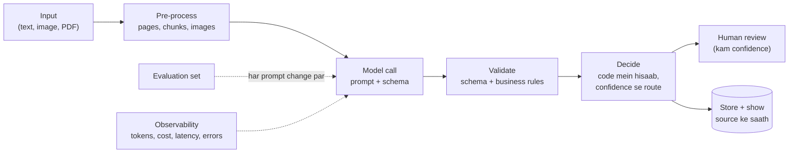
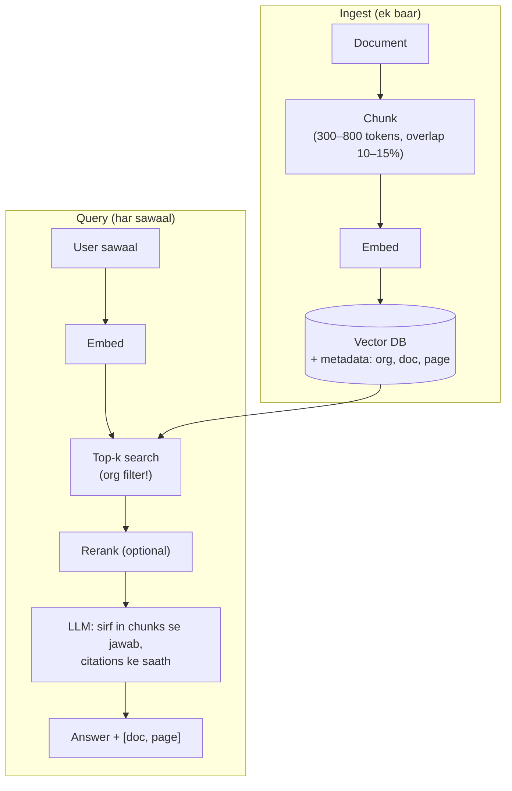

# 04. AI Engineering Deep: LLM ko product mein reliably lagana

> Target: **AI Product Engineer** wali skill, ML researcher wali nahi. Companies ko aise log chahiye jo LLM ko app mein lagayein, aur jab wo galat ho tab bhi product sahi chale.
> 8 hafte (Month 3–5). Har hafte code, aur VERDE ke asli AI pipeline se seekhna.
> Code examples TypeScript mein hain. Model ka naam `<model>` likha hai: jo provider/model aap use karein (OpenAI, Anthropic Claude, Google Gemini), uska current naam daalein.

---

## Mental model: AI feature ke 6 hisse



Interview mein jo ye 6 hisse samjha de, wo "API call karne waale" se alag dikhta hai.

---

## Hafta 1: LLM basics jo sach mein kaam aate hain

| Concept | Kya samajhna |
|---|---|
| Tokens | ~4 characters ≈ 1 token (English); Hindi/other scripts mein zyada tokens; input aur output tokens ki alag keemat |
| Context window | Kitna ek call mein bhej sakte ho; lamba context = mehnga + "beech mein kho jaana" |
| Temperature | Extraction ke liye 0 (ya kam), creative text ke liye zyada |
| System vs user message | System = rules/role; user = data. **User data ko instructions ki tarah mat chalne do** (prompt injection) |
| Streaming | Pehla token jaldi dikhana (mobile UX ke liye zaroori) |
| Model choice | Chhota/sasta model classification ke liye, bada reasoning/vision ke liye; **routing** |
| Latency | Time to first token vs total time; output tokens zyada = zyada time |
| Non-determinism | Same input, alag output; isliye validation aur evaluation zaroori |

**Khud banao:** ek CLI jo text le aur streaming summary de; har call ke input/output tokens aur cost log kare.

**VERDE mein dekho:** `ocr-service` mein `gpt-tokenizer` ka use (token counting), aur wallet credits AI usage se kaise jude hain.

---

## Hafta 2: Structured output (sabse zaroori skill)

LLM se free text nahi, **validated JSON** lena.

```ts
import OpenAI from "openai";
import { z } from "zod";

const Receipt = z.object({
  merchant: z.string(),
  date: z.string().describe("ISO date YYYY-MM-DD"),
  total: z.number(),
  currency: z.enum(["INR", "USD", "EUR"]),
  items: z.array(z.object({ name: z.string(), amount: z.number() })),
  confidence: z.number().min(0).max(1),
  evidence: z.array(z.object({ field: z.string(), quote: z.string() })),
});
type Receipt = z.infer<typeof Receipt>;

const client = new OpenAI();

export async function extractReceipt(text: string): Promise<Receipt> {
  for (let attempt = 1; attempt <= 2; attempt++) {
    const res = await client.chat.completions.create({
      model: "<model>",
      temperature: 0,
      response_format: {
        type: "json_schema",
        json_schema: { name: "receipt", strict: true, schema: z.toJSONSchema(Receipt) },
      },
      messages: [
        { role: "system", content:
          "Extract receipt data. Use only values present in the text. " +
          "If a value is missing, do not guess; lower confidence. " +
          "For each field, include an exact quote as evidence." },
        { role: "user", content: `<document>\n${text}\n</document>` },
      ],
    });
    const parsed = Receipt.safeParse(JSON.parse(res.choices[0].message.content ?? "{}"));
    if (parsed.success) return businessChecks(parsed.data);
  }
  throw new Error("EXTRACTION_FAILED");
}

function businessChecks(r: Receipt): Receipt {
  const sum = r.items.reduce((s, i) => s + i.amount, 0);
  if (Math.abs(sum - r.total) > 1) r.confidence = Math.min(r.confidence, 0.5); // code verify kare
  return r;
}
```

> Note: zod ka `toJSONSchema` zod v4 mein hai; purane version mein `zod-to-json-schema` package. `strict: true` mode mein schema ke har object mein `additionalProperties: false` aur saare fields required hone chahiye, aur kuch keywords (jaise `min`/`max`) support na hon to error aata hai. OpenAI SDK ka `zodResponseFormat` helper (`openai/helpers/zod`) ye conversion khud karta hai; SDK version ke docs dekh lein. Anthropic Claude mein yahi kaam **tool use / structured outputs** se hota hai; idea same hai.

**Seekhne ki baatein:**
- Schema hi aapka "contract" hai: enums, required fields, descriptions.
- **Evidence/quote** maangna: hallucination kam, aur UI mein source dikha sakte ho (MVP ka "source traceability").
- Validation fail → retry (error message ke saath) → phir bhi fail → human review / error.
- **Hisaab code mein:** total, percentages, thresholds, pass/fail. LLM sirf values nikale.

**VERDE mein dekho (asli production example):**
- `ocr-service/src/constants/extractionSchema.js`: badi extraction schema (values, units, page, evidence anchors).
- `ocr-service/src/analysis/factGuardrails.js` aur `expressionEvaluator.js`: LLM output ko code se jaanchna.
- **VERDE ki galti jo seekhni hai:** credit ka points/verdict LLM se aata hai, aur Excel calculator ka result kabhi wapas nahi padha jaata (`templates/calculation-sheets/CalculationSheetFiller.js` sirf `fullCalcOnLoad` lagata hai). Isliye "calculator 59% kehta hai, platform 3 points deta hai".

**Exercise:** VERDE ke liye 1-page design: "Indoor water ka % reduction code mein calculate ho (fixture flow rates × usage), LLM sirf flow rates nikale, aur verdict calculation se aaye."

---

## Hafta 3: Prompt engineering (engineering ki tarah)

| Technique | Kab |
|---|---|
| Clear role + task + output format | Hamesha |
| Rules list (do / don't) | Domain rules (VERDE: "cover page kisi credit ko nahi") |
| Few-shot examples | Format ya edge cases sikhane ke liye; 2–5 achhe examples |
| Delimiters (`<document>…</document>`) | User data ko instructions se alag |
| Step-by-step / reasoning | Complex decisions; lekin output mein sirf final JSON |
| "Agar nahi pata to null do" | Hallucination kam |
| Prompt chaining | Ek bada kaam → chhote steps (classify → extract → verify) |
| Prompt versioning | Prompts git mein, version number, har change ke saath eval |

**VERDE mein dekho:** `document-service/src/prompt/` aur `ocr-service/src/prompts/`. MVP gaps mein mila ki segregation prompt AI ko **over-label** karne ki taraf dhakelta hai (page 28) aur calculator dropdown values free text mein aati hain (pages 50, 60–63).

**Exercise:** Calculator dropdown problem fix karo design mein: schema mein `enum` exactly Excel ke data-validation list ke values; mismatch par null + "needs input".

---

## Hafta 4: Vision aur documents

| Topic | Kya |
|---|---|
| Digital PDF | Text seedha nikalo (pdf-parse / pdfjs); sasta aur sahi |
| Scanned PDF / photo | Page → image (DPI ~150–200), vision model; ya OCR (ML Kit, Tesseract, cloud OCR) + text LLM |
| Tables / drawings | High-detail image; ya table extraction tools |
| Multi-page | Batches; page number har output mein |
| Cost control | Image size, detail level, sirf zaroori pages; **sampling ka khatra** (VERDE: 100+ page PDF ke sirf 20 pages padhe → adhoora result) |
| Unreadable flag | Blurry/empty page ko "missing" se alag dikhana (MVP gap) |

**Mobile angle:** on-device OCR pehle (ML Kit / Vision; free, offline, tez), phir sirf text cloud LLM ko → sasta, private, tez. Interview mein ye trade-off bahut achha lagta hai.

**VERDE mein dekho:** `ocr-service/src/analysis/goProcessorClient.js` (Go service se page render), `documentClassifier.js` (drawing/table/text pehchaan).

---

## Hafta 5: Embeddings aur RAG



| Topic | Gehrai |
|---|---|
| Embeddings | Text → vector; similar meaning = paas; model ka dimension; same model ingest + query dono mein |
| Chunking | Fixed size vs heading/paragraph-aware; tables ko na todna; page number metadata |
| Retrieval | Cosine top-k; **metadata filter** (tenant!); hybrid (keyword + vector) kyunki codes/IDs ("WEPR2") vector search mein kho jaate hain |
| Reranking | Top 30 nikal kar cross-encoder/LLM se top 5 |
| Generation | "Sirf context se jawab do; nahi mila to bolo nahi pata"; citations |
| Failure modes | Galat chunk mila (retrieval) vs sahi chunk, galat jawab (generation): alag-alag napo |

**Khud banao (pgvector ke saath, file 03 Section 8):** 20 PDFs ingest → sawaal → jawab with `[file, page]` citations. CLI ya chhota API.

**VERDE mein dekho:** `vector-service` (Python FastAPI + sentence-transformers + CLIP + ChromaDB) aur `chat-service` (AI assistant). Exercise: chat-service ka ek sawaal kis raaste se jawab tak pahunchta hai, draw karo; tenant filter kahan lagta hai, check karo.

---

## Hafta 6: Evaluation (jo zyadatar log nahi karte, aur isliye aapko alag karega)

**Kyun:** prompt badla → kuch cases sudhre, kuch toote. Bina eval ke pata hi nahi chalta.

**Simple eval harness:**
```
evals/
  cases/
    receipt_001.txt   receipt_001.expected.json
    ...  (30–50 cases: easy, edge, ganda scan, missing fields)
  run.ts   → har case chalao, field-wise compare, report
```

| Metric | Kaise |
|---|---|
| Field accuracy | Exact match (dates, enums), tolerance (numbers ±1%) |
| Classification | Precision, recall, F1 per class; confusion matrix |
| Confidence calibration | 80% confidence wale sach mein ~80% sahi? (VERDE: auto-approve seema 55% kitni sahi hai, yahi se pata chalega) |
| RAG | Retrieval hit rate (sahi chunk top-k mein?), answer faithfulness (LLM-as-judge + human spot check) |
| Cost / latency | Per case tokens, ms; p95 |

**Rules:** har prompt/model change PR ke saath eval report; regression ho to merge nahi.

**VERDE mein dekho:** `tools/analysis-ab` (A/B analysis tool). MVP ka acceptance criteria "results match independently verified examples": yahi evaluation hai jo abhi missing hai.

**Exercise:** VERDE segregation ke liye eval plan likho: 30 documents ka golden set (sahi credits + pages), metrics, aur auto-approve threshold 55 vs 70 vs 80 par precision/recall ki table kaise banegi.

---

## Hafta 7: Production concerns

| Concern | Kya karna |
|---|---|
| Rate limits (429) | Exponential backoff + jitter; queue se concurrency control |
| Timeouts | Har call par timeout; lambi jobs queue mein |
| Fallback | Doosra model/provider; graceful "AI abhi available nahi" |
| Cost control | Per-user/org budget (VERDE wallet), caching same input ka result, prompt caching, chhota model jahan ho sake |
| Observability | Har call log: model, prompt version, tokens, cost, latency, success; dashboard |
| Privacy | PII mask, data retention, provider ki data policy, tenant data mix na ho |
| **Prompt injection** | Document mein likha ho "ignore previous instructions": user data ko delimiters mein, output schema strict, tools ke permissions limited |
| Human in the loop | Kam confidence → review queue; review ke corrections save karke eval set mein daalo |

**VERDE mein dekho:** chat-service ka `opossum` circuit breaker; segregation ka review flow (approve/reject/correct); MVP gap: "correction save nahi hota" (`correctSegregation`), yaani feedback loop toota hua hai.

---

## Hafta 8: Agents, tool use, aur mobile + AI

**Tool use / function calling:** model ko functions ki list do (`searchDocuments`, `getProjectStatus`); model call maange → aap chalao → result wapas. Agent = ye loop kai steps tak. **MCP (Model Context Protocol):** tools ko standard tareeke se expose karna. SDE-2 level par: ek simple 2–3 tool wala assistant bana paana aur iske risks (galat tool call, loops, permissions) bolna.

**Mobile + AI (aapka unique angle):**
| Feature | Kaise |
|---|---|
| Streaming chat UI | SSE/stream → tokens append; cancel button; retry; markdown render |
| Camera → AI | On-device crop/enhance/OCR → upload → server extraction → result screen with "edit values" |
| Offline | On-device model (ML Kit, Gemini Nano, Apple Foundation Models) ya queue karke baad mein |
| UX of uncertainty | Confidence dikhana, "AI ne ye nikala, check karein", edit karne do (VERDE ka MVP gap: extraction edit nahi hota) |
| Cost on mobile | Server-side proxy (API key app mein kabhi nahi), per-user limits |

---

## AI checkpoint (Month 5 end)

- [ ] Structured extraction with zod schema + retry + business checks + evidence
- [ ] Vision se photo/PDF extraction; on-device OCR vs cloud ka trade-off samjha paana
- [ ] RAG with pgvector, tenant filter, citations
- [ ] 30-case eval harness with report
- [ ] Token/cost logging, rate-limit handling
- [ ] VERDE ke 3 design notes: calculator se verdict, dropdown enums, segregation eval plan

## AI ke 20 interview sawaal

1. Token kya hai; cost kaise estimate karoge 10,000 documents ke liye?
2. Temperature 0 par bhi output alag kyun aa sakta hai?
3. Guaranteed JSON kaise; validation fail ho to?
4. Hallucination kam karne ke 5 tareeke.
5. LLM ko calculation kyun nahi karne dena chahiye?
6. RAG vs fine-tuning: kab kya?
7. Chunk size kaise chunoge; tables ka kya?
8. Vector search mein product codes ("WEPR2") kyun miss hote hain; fix?
9. RAG mein jawab galat: retrieval problem ya generation problem, kaise pata?
10. Eval set kaise banaoge; kitne cases?
11. Confidence score par kitna bharosa? Calibration kya hai?
12. Prompt injection ka example aur bachav.
13. Multi-tenant RAG mein data leak kaise rokoge?
14. Rate limit 429 aur bursty traffic.
15. Model provider down hai: kya karoge?
16. Streaming response mobile par kaise dikhayenge; network toot jaaye to?
17. On-device vs cloud AI: 4 trade-offs.
18. Agent kya hai; kab overkill hai?
19. Human-in-the-loop design: review corrections ka kya karoge?
20. AI feature ki success kaise napoge (product metrics)?
