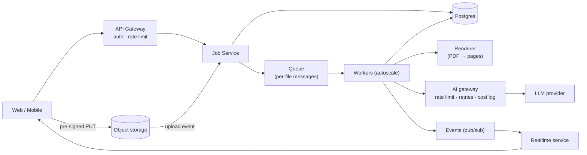

# 06. System Design Deep: LLD, HLD, Mobile System Design

> 3–4 saal waale (SDE-2) ke interview mein aam taur par: **1 LLD ya mobile system design round + kabhi kabhi 1 HLD round**.
> SDE-2 se expect: requirements clear karna, saaf structure, 2 cheezon mein gehrai, aur **trade-offs bolna**. Perfect answer koi nahi hota.
> Mobile system design ka poora framework aur chat app example: [01_Mobile_Deep.md](01_Mobile_Deep.md) Section 4.

---

## Part A: Low-Level Design (LLD)

### A1. Kya aana chahiye

| Topic | Gehrai |
|---|---|
| OOP | Encapsulation, abstraction, inheritance vs **composition (composition prefer karo)**, polymorphism |
| **SOLID** | Har letter ka ek code example aur uska violation |
| Design patterns (zaroori 10) | Singleton (aur iske nuksaan), Factory / Abstract Factory, Builder, **Strategy**, **Observer**, Decorator, Adapter, Facade, **Repository**, State, Command, Chain of Responsibility (middleware!) |
| UML-lite | Class diagram: classes, fields, methods, relationships (has-a, is-a) |
| Concurrency | Thread-safe classes, locks, producer-consumer, immutability |
| Clean code | Naming, chhote functions, dependency injection, testability |

### A2. LLD interview ka process (45 min)
1. **Requirements (5 min):** core use cases 3–5; kya scope se bahar hai.
2. **Entities (5 min):** nouns → classes; verbs → methods.
3. **Class diagram (10 min):** relationships, interfaces jahan behaviour badal sakta hai.
4. **Code (20 min):** core classes + main flow, patterns jahan sach mein zaroori.
5. **Extensions (5 min):** "naya payment type aaye to?" → Strategy ki wajah se ek class add.

### A3. Worked example: Parking Lot (short)
- **Entities:** `ParkingLot`, `Floor`, `Spot` (Small/Medium/Large), `Vehicle` (Bike/Car/Truck), `Ticket`, `EntryGate`, `ExitGate`, `PricingStrategy`, `PaymentProcessor`.
- **Patterns:** `SpotAllocationStrategy` (nearest / floor-wise) = Strategy; `PricingStrategy` (hourly / flat / weekend) = Strategy; display boards = Observer (spot free hone par update); `ParkingLot` ek instance (Singleton ka zikr, lekin DI behtar bolo).
- **Concurrency:** do gates ek hi spot allot na karein → spot allocate karte waqt lock / atomic compare-and-set.
- **Extension:** EV charging spots → naya `SpotType` + allocation strategy mein filter.

### A4. Practice list (mobile/backend dono ke liye relevant)
| Problem | Kya test hota hai |
|---|---|
| Parking lot | Basic OOP + strategy |
| **Image loading/caching library** ⭐ (mobile) | Memory + disk LRU cache, request dedupe, cancellation, decoding thread pool |
| **Rate limiter** ⭐ | Token bucket / sliding window classes, thread safety |
| Logger library | Levels, appenders (Chain/Observer), async writes |
| Notification system (in-app) | Observer, channels (Strategy), retry |
| Splitwise | Entities + balance simplification |
| Elevator | State pattern, scheduling |
| BookMyShow seat booking | Concurrency: seat lock with timeout |
| **Analytics SDK** ⭐ (mobile) | Event queue, batching, persistence, retry, offline |
| **File upload manager** ⭐ (mobile, VERDE jaisa) | Queue, parallel N, progress, pause/resume/cancel, retry per file |
| Snake & Ladder / Tic-tac-toe | Basic (warm-up) |
| Cache with TTL + LRU | Data structures + design |

### A5. Worked example: File Upload Manager (mobile, VERDE ke segregation upload jaisa)

**Requirements:** 250 files tak; ek saath max 3 uploads; har file ka progress; pause/resume/cancel (per file aur sab); fail par 3 retry with backoff; app background mein jaaye to bhi chale (OS limits ke andar); duplicate file (same hash) skip.

**Classes:**
```
UploadManager                      // facade, public API
  - queue: UploadQueue
  - scheduler: Scheduler(maxParallel = 3)
  - store: UploadStore             // persistence (local DB) for resume after app kill
  - listeners: List<UploadListener>  // Observer
  + enqueue(files): List<UploadId>
  + pause(id) / resume(id) / cancel(id) / pauseAll()
  + observe(id): Flow<UploadState>

UploadTask
  - id, file, sha256, state: UploadState, attempt, bytesSent
  + run(): suspend / async

UploadState  (State pattern / sealed class)
  Queued | Uploading(progress) | Paused | Retrying(nextAt) | Completed(remoteId) | Failed(reason) | Cancelled

Uploader (interface)               // Strategy: SimpleUploader, ChunkedResumableUploader, PresignedUrlUploader
RetryPolicy (interface)            // ExponentialBackoff(maxAttempts=3, base=1s, jitter)
DuplicateChecker                   // hash-based
```
**Flow:** enqueue → hash → duplicate? skip → store mein `Queued` → scheduler free slot dekhe → task run → progress events → success `Completed` / error → RetryPolicy → `Retrying` ya `Failed`.
**Bolne ki gehrai:** pause = cooperative (chunk ke beech check), resumable upload ke liye server se offset; state persist taaki app kill ke baad resume; listeners ko main thread par events; cancel par server-side cleanup.
**VERDE se jodo:** "Maine dekha hai production mein pause turant nahi rukta aur retry sab kuch dobara chalata hai. Mera design per-file state aur cooperative pause se ye dono rokta hai." Ye line interview mein bahut asar karti hai.

---

## Part B: High-Level Design (HLD)

### B1. Building blocks (har ek ki 5-line samajh)

| Block | Kab / kyun |
|---|---|
| Load balancer | Traffic baantna, health checks, L4 vs L7 |
| API gateway | Auth, rate limit, routing ek jagah |
| Stateless app servers | Horizontal scale; session Redis mein |
| Cache (Redis) | Read-heavy, latency kam; invalidation |
| CDN | Static files, images, video paas se |
| SQL DB | Relationships, transactions |
| NoSQL | Huge scale, simple access patterns, flexible schema |
| Replication | Read scale, availability; replication lag |
| Sharding / partitioning | Write scale; shard key ka chunav; hot shards |
| Message queue / stream | Async, decoupling, spikes (SQS, RabbitMQ, Kafka) |
| Object storage | Files (S3, Azure Blob) |
| Search | Elasticsearch/OpenSearch: full-text |
| Vector DB | Semantic search / RAG |
| Rate limiter | Abuse rokna, fair use |
| Observability | Logs, metrics, traces, alerts |

**Concepts:** CAP (partition ho to consistency ya availability), eventual consistency, idempotency, back-of-the-envelope estimation (QPS, storage), SLA/SLO (99.9% = ~8.7 ghante downtime/saal), p50/p95/p99.

### B2. HLD process (45 min)

| Step | Min | Kya |
|---|---|---|
| Requirements | 5 | Functional (3–4), non-functional (scale, latency, consistency, availability) |
| Estimation | 3 | Users, QPS (read/write), storage per saal (seedhi math) |
| API | 5 | Main endpoints |
| Data model | 5 | Tables/collections, keys |
| High-level diagram | 10 | Client → LB → services → DB/cache/queue/storage |
| Deep dives | 12 | 2 bottlenecks: scaling, consistency, failures |
| Wrap-up | 5 | Trade-offs, monitoring, kya aage sudhaar |

### B3. Worked example (poora): "Design a document upload + AI processing system" (VERDE jaisa)

**1. Requirements**
- Functional: user project mein bahut saari files upload kare (250 files, 750 MB tak); AI har file ko classify kare (kis category ki, kaunse pages); result review kare; progress dikhe; pause/cancel.
- Non-functional: 10k organizations, peak 500 jobs/ghanta; ek org ka data doosre ko kabhi na dikhe; AI cost control (per-org budget); job 30 min mein khatam (typical); koi file kabhi khoye nahi.

**2. Estimation**
- 500 jobs/h × avg 50 files = 25k files/h ≈ 7 files/s processing.
- Avg file 3 MB → ~75 GB/h upload peak; storage ~ (say 20k jobs/din × 150 MB) = 3 TB/din worst case → object storage + lifecycle rules.
- AI calls: avg 20 pages/file → ~140 page-calls/s peak → provider rate limits = **sabse bada bottleneck** → queue + concurrency control + batching.

**3. API**
```
POST   /v1/projects/{pid}/jobs                 → 201 {jobId}   (credits estimate + hold)
POST   /v1/jobs/{jobId}/files                  → pre-signed upload URLs (batch)
POST   /v1/jobs/{jobId}/start                  → 202
GET    /v1/jobs/{jobId}                        → status, counts, per-file states
POST   /v1/jobs/{jobId}/pause | resume | cancel
GET    /v1/jobs/{jobId}/results?cursor=        → per-file classification
POST   /v1/results/{rid}/review                → approve / reject / correct
WS     /v1/stream?projectId=                   → progress events
```

**4. Data model (Postgres)**
```
jobs(id, org_id, project_id, status, total_files, done_files, failed_files,
     credits_held, credits_used, created_by, created_at)          -- index (org_id, project_id, status)
job_files(id, job_id, org_id, blob_key, sha256, size, status
          [PENDING|UPLOADED|PROCESSING|DONE|FAILED], attempts, error_code)
results(id, job_file_id, org_id, category, pages int[], confidence,
        evidence jsonb, review_status, reviewed_by, corrected_category)
wallet(org_id, balance, held)   wallet_ledger(id, org_id, job_id, type, amount)
```

**5. Architecture**


**6. Deep dives (inme se 2 chuno, gehrai se)**

*a) Reliability aur idempotency*
- Har file = alag queue message (job = fan-out). Worker step-by-step: status check → `PROCESSING` → AI → result upsert (`job_file_id` unique) → `DONE`. Message do baar aaye to `DONE` dekh kar skip.
- Retry: per-file attempts (max 3, backoff); job "failed" sirf jab saari files terminal ho jaayein aur failure threshold paar ho. **Restart = sirf `!= DONE` files dobara.**
- Worker crash: visibility timeout / stalled detection → message wapas queue mein.

*b) AI rate limits aur cost*
- Central AI gateway: token bucket per provider + per-org concurrency (ek org baaki sab ko block na kare = fairness).
- Credits: start par estimate hold (DB transaction), har file ke baad actual ledger entry, end par settle; budget khatam → job `PAUSED_INSUFFICIENT_CREDITS` (failed nahi).
- Cache: same `sha256` + same prompt version ka result reuse.

*c) Multi-tenancy aur security*
- Har table mein `org_id`; har query `org_id` se (repository layer enforce kare) ya Postgres RLS; job access mismatch = 404.
- Blob keys `org/{orgId}/...`; pre-signed URL short expiry; server-side size/type/hash verify; virus scan step.

*d) Pause / cancel*
- Job status `PAUSED` → workers next file uthane se pehle check; in-flight file khatam hone do (ya cooperative check pages ke beech).
- Cancel: pending messages skip, held credits release.

*e) Progress*
- Worker events → pub/sub → realtime service → WS rooms per project; fallback polling `GET /jobs/{id}` (ETag ke saath).

**7. Trade-offs bolo**
- Per-file messages vs per-job message: zyada messages, lekin retry aur parallelism behtar.
- Auto-approve threshold: zyada = kam review, zyada galat filing → eval data se tay karo.
- Sync AI call vs batch API: batch sasta, lekin slow.

**8. Monitoring:** queue depth, oldest message age, per-file latency p95, AI error rate, cost per job, failed files by reason; alerts.

### B4. Practice list (HLD)
| # | Sawaal | Focus |
|---|---|---|
| 1 | URL shortener ⭐ | Basics, key generation, cache |
| 2 | Rate limiter (distributed) ⭐ | Redis, algorithms |
| 3 | Notification system ⭐ | Fan-out, push/email/SMS, retries, preferences |
| 4 | Chat system (backend) ⭐ | WebSocket scale, storage, ordering, presence |
| 5 | News feed / Instagram ⭐ | Fan-out on write vs read, cache, media CDN |
| 6 | File storage (Google Drive) | Chunking, sync, versioning, sharing |
| 7 | Ride sharing (Uber) | Location updates, geo index, matching |
| 8 | Document AI pipeline (upar) ⭐ | Queues, AI limits, multi-tenancy |
| 9 | RAG-based assistant for a SaaS ⭐ | Ingestion, vector DB, tenant isolation, eval |
| 10 | Payment / wallet system | Ledger, idempotency, consistency |

---

## Part C: 16-hafte ka system design plan (Month 3–7, Sunday + 2 weekday evenings)

| Hafte | Kya |
|---|---|
| 1–2 | OOP + SOLID + 10 patterns (har pattern ka chhota code apne language mein) |
| 3–4 | LLD: Parking lot, Rate limiter, LRU+TTL cache, Logger |
| 5–6 | LLD (mobile): Image loader, File upload manager, Analytics SDK |
| 7–8 | Mobile system design: chat app, Instagram feed, offline notes (file 01 Section 4) |
| 9–10 | HLD building blocks + estimation; URL shortener, rate limiter |
| 11–12 | HLD: notification system, chat backend |
| 13–14 | HLD: news feed, document AI pipeline (upar) |
| 15–16 | Mocks: har hafte 2 (1 LLD/mobile, 1 HLD), record karke dekhna |

**Resources:** "System Design Interview" Vol 1 & 2 (Alex Xu), ByteByteGo, "Designing Data-Intensive Applications" (chapters 1–3, 5–9), Refactoring.Guru (design patterns), Mobile System Design: "Mobile System Design Interview" (Manuel Vicente Vivo) aur weeklyteam/mobile-system-design (GitHub).

**Self-evaluation rubric (har mock ke baad 1–5):**
| Criterion | Score |
|---|---|
| Requirements aur scope clear kiye? | |
| Estimation sensible? | |
| Diagram saaf, components justified? | |
| Data model sahi? | |
| 2 deep dives mein gehrai? | |
| Trade-offs khud bole? | |
| Time management? | |
