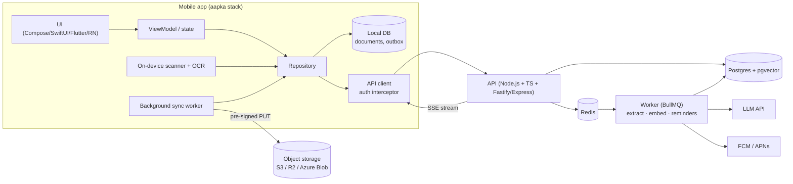

# 07. Flagship Project: "DocSnap" (poora spec)

> Ek project jo aapka poora profile dikhaye: **mobile (gehrai) + backend + Postgres + queue + AI + deploy + tests**.
> Naam aapki marzi; yahan "DocSnap" likha hai. Idea VERDE se inspired hai, lekin domain alag (personal/small-business documents), taaki ye **aapka apna** kaam ho aur kisi company ka code/data use na ho.
> 10 hafte, weekends + 2 evenings.

---

## 1. Product (1 paragraph jo README mein jaayega)

DocSnap ek mobile app hai jisme user bills, receipts, warranty cards aur certificates ki photo/PDF daalta hai. App on-device page detect + crop karta hai, upload karta hai, aur backend AI se structured data nikalta hai (merchant, date, amount, category, warranty expiry). User values check/edit kar sakta hai, search kar sakta hai, aur apne documents se sawaal pooch sakta hai ("is saal electronics par kitna kharcha?", "fridge ki warranty kab khatam?"). Offline mein scan karke queue mein rakhta hai, online hone par sync. Warranty khatam hone se pehle push reminder.

---

## 2. Features aur kya skill dikhata hai

| # | Feature | Skill jo dikhti hai | Priority |
|---|---|---|---|
| F1 | Signup/login (email + Google), token refresh | Auth, secure storage, concurrent 401 handling | Must |
| F2 | Camera scan: edge detect, crop, multi-page, PDF import | Camera, on-device ML (ML Kit / Vision document scanner), image processing | Must |
| F3 | Offline queue + background upload with progress, retry, pause | Offline-first, outbox, WorkManager/BGTask, pre-signed URL upload | Must |
| F4 | AI extraction (structured, evidence ke saath) | Queue worker, LLM structured output, validation, business checks | Must |
| F5 | Review screen: extracted values edit, confidence highlight, source quote | Mobile UX for AI uncertainty, PATCH API, optimistic update | Must |
| F6 | List + search + filters (category, date range), infinite scroll | Pagination (cursor), local DB cache, full-text search | Must |
| F7 | "Ask your documents" chat (RAG) streaming | Embeddings, pgvector, citations, streaming UI | Should |
| F8 | Warranty reminders (push) | Cron job, FCM/APNs, deep link to document | Should |
| F9 | Monthly spend dashboard | SQL aggregation, charts | Should |
| F10 | Eval report for extraction | AI evaluation maturity | Must (chhota) |
| F11 | Admin metrics: AI tokens/cost per user | Observability, cost control | Could |

**MVP = F1–F6 + F10.** Pehle ye poora aur saaf, phir baaki.

---

## 3. Architecture



**Repo structure (monorepo):**
```
docsnap/
  apps/mobile/            # aapka stack
  apps/api/               # Node + TS
  apps/worker/            # same codebase, alag entry point
  packages/shared/        # zod schemas, types (RN ho to mobile bhi use kare)
  infra/docker-compose.yml
  evals/                  # extraction eval cases + runner
  docs/architecture.md, docs/decisions/ (ADRs)
  .github/workflows/ci.yml
```

---

## 4. Database schema (Postgres)

```sql
CREATE EXTENSION IF NOT EXISTS vector;
CREATE EXTENSION IF NOT EXISTS pgcrypto;

CREATE TABLE users (
  id UUID PRIMARY KEY DEFAULT gen_random_uuid(),
  email TEXT UNIQUE NOT NULL,
  password_hash TEXT,
  created_at TIMESTAMPTZ NOT NULL DEFAULT now()
);

CREATE TABLE refresh_tokens (
  id UUID PRIMARY KEY DEFAULT gen_random_uuid(),
  user_id UUID NOT NULL REFERENCES users(id) ON DELETE CASCADE,
  token_hash TEXT NOT NULL,
  family_id UUID NOT NULL,          -- rotation + reuse detection
  revoked_at TIMESTAMPTZ,
  expires_at TIMESTAMPTZ NOT NULL
);

CREATE TABLE documents (
  id UUID PRIMARY KEY,               -- client-generated (offline-safe)
  user_id UUID NOT NULL REFERENCES users(id) ON DELETE CASCADE,
  status TEXT NOT NULL CHECK (status IN ('uploading','queued','processing','ready','failed')),
  blob_key TEXT,
  sha256 TEXT,
  page_count INT,
  category TEXT,
  merchant TEXT,
  doc_date DATE,
  amount NUMERIC(12,2),
  currency TEXT,
  warranty_until DATE,
  confidence REAL,
  extraction JSONB,                  -- raw AI output + evidence
  user_edited BOOLEAN NOT NULL DEFAULT false,
  search_tsv TSVECTOR,
  created_at TIMESTAMPTZ NOT NULL DEFAULT now(),
  updated_at TIMESTAMPTZ NOT NULL DEFAULT now(),
  deleted_at TIMESTAMPTZ
);
CREATE UNIQUE INDEX ON documents (user_id, sha256) WHERE deleted_at IS NULL;
CREATE INDEX ON documents (user_id, created_at DESC, id DESC);   -- cursor pagination
CREATE INDEX ON documents (user_id, category, doc_date);
CREATE INDEX ON documents USING GIN (search_tsv);
CREATE INDEX ON documents (warranty_until) WHERE warranty_until IS NOT NULL;

CREATE TABLE doc_chunks (
  id BIGSERIAL PRIMARY KEY,
  document_id UUID NOT NULL REFERENCES documents(id) ON DELETE CASCADE,
  user_id UUID NOT NULL,
  page INT,
  content TEXT NOT NULL,
  embedding vector(1536)
);
CREATE INDEX ON doc_chunks USING hnsw (embedding vector_cosine_ops);
CREATE INDEX ON doc_chunks (user_id);

CREATE TABLE ai_usage (
  id BIGSERIAL PRIMARY KEY,
  user_id UUID NOT NULL,
  document_id UUID,
  purpose TEXT NOT NULL,             -- extract | embed | chat
  model TEXT NOT NULL,
  prompt_version TEXT NOT NULL,
  input_tokens INT, output_tokens INT, cost_usd NUMERIC(10,6), latency_ms INT,
  ok BOOLEAN NOT NULL,
  created_at TIMESTAMPTZ NOT NULL DEFAULT now()
);

CREATE TABLE devices (
  id UUID PRIMARY KEY DEFAULT gen_random_uuid(),
  user_id UUID NOT NULL REFERENCES users(id) ON DELETE CASCADE,
  push_token TEXT UNIQUE NOT NULL,
  platform TEXT NOT NULL
);
```

**Mobile local DB:** `documents` (mirror + `syncState`), `outbox(id, op, payload, attempt, nextRetryAt)`, `pages(documentId, localPath, order)`.

---

## 5. API (OpenAPI mein likhna)

| Method | Path | Notes |
|---|---|---|
| POST | `/v1/auth/signup`, `/v1/auth/login` | access (15 min) + refresh (30 din) |
| POST | `/v1/auth/refresh` | rotation; purana token dobara aaye → poori family revoke |
| POST | `/v1/auth/logout` | refresh revoke + device token hatao |
| POST | `/v1/documents` | body: `{id (uuid), sha256, pageCount, contentType}` → `201 {uploadUrl}`; same sha256 → `409` + existing id; **idempotent** on `id` |
| POST | `/v1/documents/{id}/uploaded` | server verify (size/hash) → job enqueue → `202` |
| GET | `/v1/documents?cursor=&limit=&category=&from=&to=&q=` | cursor pagination, filters, full-text `q` |
| GET | `/v1/documents/{id}` | ETag |
| PATCH | `/v1/documents/{id}` | user edits (`If-Match` version) → `user_edited = true`, eval ke liye correction log |
| DELETE | `/v1/documents/{id}` | soft delete, blob lifecycle |
| GET | `/v1/stats/monthly?year=` | SQL aggregation |
| POST | `/v1/chat` | `{question}` → **SSE stream** tokens + `citations: [{documentId, page}]` |
| POST | `/v1/devices` | push token register |

**Error format (har jagah same):** `{ "error": { "code", "message", "details", "requestId" } }`.

---

## 6. AI pipeline (worker)

```
extract job (documentId):
  1. status = processing (if already ready → return)        ← idempotent
  2. blob download → pages
  3. text: on-device OCR text (mobile ne bheja) ya server PDF text; scanned page → vision model
  4. LLM call: zod schema (merchant, date, amount, currency, category enum,
     warranty_until, items[], confidence, evidence[{field, quote, page}])
  5. validate (zod) → fail → 1 retry with error → fail → status failed (reason)
  6. business checks in CODE: items sum ≈ amount; date not in future; currency enum;
     warranty_until > doc_date; mismatch → confidence down
  7. save columns + extraction JSONB + search_tsv
  8. chunks → embeddings → doc_chunks
  9. ai_usage row (tokens, cost, latency, prompt_version)
  10. status = ready → push/SSE event
```
- **Prompt versioning:** `prompts/extract.v3.md`; version DB mein har result ke saath.
- **Cost guard:** per-user daily token budget (Redis counter); exceed → 429 with clear message.
- **Rate limit:** BullMQ worker concurrency + limiter (e.g. N jobs/sec).

**Evals (`evals/`):** 30–50 apne (fake/anonymized) receipts: `case.jpg` + `expected.json`. `pnpm eval` → field-wise accuracy, confidence calibration table, cost/latency. Report README mein. Har prompt change ke saath CI mein chale (ya manually + report commit).

---

## 7. Mobile screens

| Screen | Gehrai jo dikhani hai |
|---|---|
| Onboarding / login | Form validation, error states, secure token storage |
| Home (list) | Paging, pull-to-refresh, offline banner, per-item sync state (uploading %, processing, ready, failed + retry) |
| Scanner | Document scanner API, multi-page, reorder, crop |
| Upload queue | Pause/resume/cancel, background, app kill ke baad resume |
| Document detail / review | Extracted fields with confidence colors, "source" quote tap → page image highlight, edit + save (optimistic + conflict 412 handle) |
| Search + filters | Debounced search, local + remote results |
| Chat | Streaming tokens, cancel, citations tap → document |
| Insights | Monthly chart |
| Settings | Logout (token cleanup), notification toggle |

**Non-functional (mobile):** startup < 1.5 s (measure karke README mein), 1000-item list smooth, process death par review screen ke edits bache, dark mode, accessibility labels, crash reporting (Sentry/Crashlytics), CI build.

---

## 8. 10-hafte milestones

| Hafta | Backend | Mobile | Done = |
|---|---|---|---|
| 1 | Monorepo, docker-compose (pg, redis), auth (signup/login/refresh rotation), tests | Project setup, architecture, DI, login screens, secure storage | Login end-to-end; API tests green; CI chal raha |
| 2 | Documents create + pre-signed upload + `uploaded` endpoint | Scanner + local DB + outbox | Scan → local save |
| 3 | BullMQ worker skeleton, idempotent status machine | Background upload with progress/pause/retry | Offline scan → online auto upload |
| 4 | AI extraction v1 (schema + validation + business checks) | Home list with sync states, polling/SSE | Photo → 30 s mein extracted data app mein |
| 5 | Evals (30 cases) + prompt v2 based on report | Review/edit screen, optimistic update | Eval report v1 → v2 improvement documented |
| 6 | Cursor pagination, filters, full-text search, ETags | Search + filters, paging | 1000 docs smooth |
| 7 | Embeddings + RAG chat (SSE, citations) | Chat screen streaming | "Fridge warranty kab tak?" sahi jawab + citation |
| 8 | Reminders cron + push, monthly stats | Push + deep link, insights chart | Reminder tap → document |
| 9 | Rate limits, cost budget, ai_usage dashboard query, logs | Performance pass (startup, list), a11y, crash reporting | Numbers README mein |
| 10 | Deploy (Render/Fly/Railway + managed Postgres), README, ADRs | TestFlight / Play internal testing (ya APK + video) | Live demo + 2-min video + blog post |

---

## 9. README checklist (recruiter 60 second mein yahi dekhega)

- [ ] 1 line: kya hai + GIF/screenshot
- [ ] Demo link / video / store link
- [ ] Architecture diagram
- [ ] Tech stack (mobile, backend, DB, AI, infra)
- [ ] **Engineering highlights** (5 bullets, numbers ke saath): "Offline-first upload with outbox; resumes after app kill", "Idempotent workers; duplicate uploads detected via SHA-256", "Extraction accuracy 78% → 91% across 40-case eval after prompt v2 + code checks", "Cold start 1.3 s (measured with X)", "Per-user AI cost cap; avg cost ₹0.4/document"
- [ ] How to run locally (`docker compose up`, env example)
- [ ] Tests kaise chalayein; CI badge
- [ ] Decisions (ADRs): pgvector vs dedicated vector DB; pre-signed upload; on-device OCR first
- [ ] Known limitations + next steps

---

## 10. Interview mein project kaise sunaana (2 minute version)

> "Maine DocSnap banaya: ek mobile app jisme user bills/warranty scan karte hain aur AI unka data nikalta hai. Mobile side par offline-first rakha: scans local DB aur outbox mein jaate hain, background worker pre-signed URLs se upload karta hai aur app kill ke baad bhi resume karta hai. Backend Node/TypeScript aur Postgres par hai; processing BullMQ workers mein, jo idempotent hain taaki retry par duplicate kaam na ho. AI extraction ke liye maine strict JSON schema aur evidence quotes use kiye, aur amounts ka cross-check code mein kiya, LLM par nahi chhoda. 40 documents ka eval set banaya, jisse accuracy 78 se 91% tak gayi. Sabse mushkil hissa tha concurrent token refresh aur upload resume; maine use … se solve kiya."

Uske baad interviewer kisi bhi hisse mein gehra jaayega: isliye har hisse ka "kyun" yaad rakho (ADRs isi liye).

---

## 11. Agar VERDE par kaam kar rahe ho

DocSnap ke saath-saath VERDE ke asli fixes (file 02 ki exercises: IDOR, retry, run-history cache, calculator enums) **company ki permission ke andar** karein. Resume par dono: "production multi-tenant SaaS" + "own end-to-end project". Company ka code ya data apne public project mein kabhi mat daalein.
