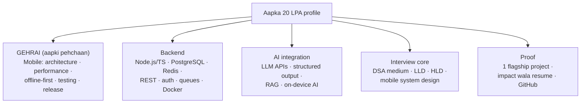
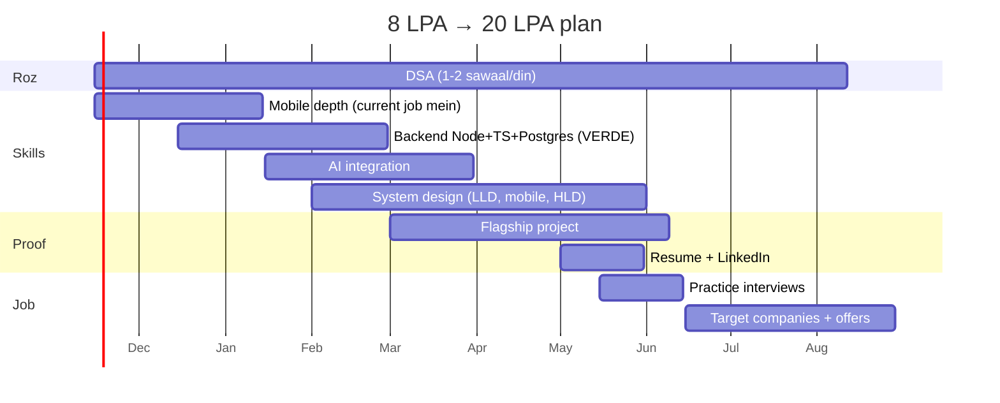

# Mobile Developer (3 saal, 8 LPA) se 20 LPA tak: mentor wala plan

> Ye plan aapke liye hai: 3 saal ke mobile app developer, abhi 8 LPA, aur target 20 LPA.
> Salary ranges India ke 2025–26 ke aam trends par andaaza hain. City, company aur interview performance se kaafi badalti hain, isliye Levels.fyi, AmbitionBox aur Glassdoor par khud verify karein.
> Skills ki poori list: [VERDE_Full_Stack_SDE1_Skills.md](VERDE_Full_Stack_SDE1_Skills.md)
> **Ye sirf overview hai. Har area ka week-by-week deep plan: [Career_Roadmap/00_START_HERE.md](Career_Roadmap/00_START_HERE.md)**

---

## 1. Pehle sach baat (mentor ki taraf se)

**1. 20 LPA mumkin hai, lekin "seekh lo" se nahi, "interview clear karo" se milega.**
Ek hi company mein 8 → 20 almost kabhi nahi hota. Ye jump **switch** se hota hai, aur switch tab hota hai jab aap **product company** ka interview clear karte ho. Isliye plan ka har hissa ek sawaal se judta hai: *"Isse mera interview ya resume kaise strong hoga?"*

**2. 3 saal ke experience par aap SDE-1 nahi, SDE-2 ke liye interview doge.**
Pichhla document SDE-1 ka tha. Aapke liye bar thoda upar hai: **ownership, system design aur "kyun" samjhana**. Sirf feature banana kaafi nahi.

**3. Mobile chhodna nahi hai. Mobile aapki taakat hai.**
Market mein web full stack developers bahut hain. **Mobile + Backend + AI** waale bahut kam hain. Aapko apna 3 saal ka experience phenkna nahi, uske upar banana hai.

**4. Realistic timeline: 6–9 mahine ki focused taiyari.**
Roz ~2 ghante (weekdays) + weekend par 5–6 ghante. Isse kam mein ho sakta hai, lekin consistency zyada zaroori hai speed se.

**5. 8 → 20 (2.5x) seedha bhi ho sakta hai, do step mein bhi.**
- Strong taiyari + 2–3 offers saath mein → seedha 18–25 LPA mumkin hai.
- Taiyari adhoori ho → pehle 14–16 LPA wali achhi product company, 1–1.5 saal baad 22–28.
Dono raaste theek hain. Galat raasta hai **kamzor taiyari ke saath jaldi switch karna** aur service company mein 30% hike le kar ruk jaana.

---

## 2. Market mein 20 LPA kahan milta hai (3–4 saal experience)

| Company type | 3–4 saal par approx. salary | Kya chahiye |
|---|---|---|
| Service companies (TCS, Infosys, Wipro jaise) | 6–12 LPA | Yahan 20 LPA ka raasta nahi |
| Mid-size product / funded startups (Series B+), SaaS, fintech | **18–35 LPA** | DSA medium, system design basics, strong project depth ← **aapka main target** |
| AI-first startups | 20–40 LPA | AI integration ka asli kaam, tez shipping |
| Top product / MAANG (SDE-2) | 35–60+ LPA (stocks ke saath) | DSA medium–hard, LLD + HLD strong |

**Target roles (search keywords):**
- Senior Mobile Engineer / SDE-2 Mobile
- Full Stack Engineer (Mobile + Backend)
- Product Engineer
- Mobile Engineer, AI features

---

## 3. Aapka target profile: "T-shaped" engineer

Interviewer ko ye kahani sunani hai:
> *"Main ek mobile engineer hoon jo poora feature khud bana sakta hai: app, backend API, database aur AI. Aur maine ye production jaise project mein karke dikhaya hai."*

---

## 4. Pehle apne mobile skills ko current industry level par laao (Month 1–2)

Ye sabse pehle, kyunki interviews mein aapse **sabse gehre sawaal mobile par** honge. 3 saal waale se ye expect hota hai:

| Area | 2026 mein kya aana chahiye |
|---|---|
| **Modern UI** | Android: Jetpack Compose · iOS: SwiftUI · Flutter: latest Flutter/Dart 3 · React Native: New Architecture (Fabric, TurboModules), Expo |
| **Architecture** | MVVM / MVI / Clean Architecture, modularization, dependency injection (Hilt / Koin / Riverpod), kyun aur kab |
| **Concurrency** | Kotlin Coroutines + Flow · Swift async/await + actors · Dart isolates/streams · JS event loop |
| **State management** | Unidirectional data flow; Flutter: Riverpod/Bloc; RN: Redux Toolkit / Zustand / React Query |
| **Networking + offline** | Retrofit/Ktor/URLSession/Dio, caching, **offline-first sync** (local DB: Room / SwiftData / Core Data / SQLite / Drift), conflict resolution, retries |
| **Performance** | Startup time, jank/frame drops, memory leaks, profiling (Android Studio Profiler, Instruments, Flutter DevTools), image caching, list virtualization |
| **Testing** | Unit, UI tests (Espresso / XCTest / widget tests / Detox / Maestro), mocking |
| **Release engineering** | CI/CD (Fastlane, GitHub Actions, Bitrise), code signing, staged rollouts, feature flags, crash monitoring (Crashlytics / Sentry), analytics |
| **Security** | Secure storage (Keystore / Keychain), certificate pinning, token refresh, obfuscation |
| **Accessibility** | Screen readers, dynamic text size |
| **On-device AI (naya, demand mein)** | ML Kit, Core ML, TensorFlow Lite / LiteRT, Gemini Nano / Apple Foundation Models, camera + OCR features |

**Mentor tip:** apne current job ke kaam mein in mein se 2–3 cheezein **asli mein lagaao** (jaise app startup time 30% kam karna, crash rate kam karna). Resume par number ke saath likhne ko milega. Ye kisi course se zyada keemti hai.

---

## 5. Backend (Month 2–4): VERDE aapka training ground hai

Aapke paas ek asli production codebase hai. Ye bahut badi baat hai, zyadatar log tutorials se seekhte hain.

**Backend ke liye Node.js + TypeScript chunein.** Wajah:
- VERDE ka backend yahi hai, roz practice milegi.
- Market mein sabse zyada demand.
- Agar aap React Native par ho to language same hai. Kotlin/Swift/Dart se bhi TS seekhna aasaan hai.

| Hafta | Seekhna | VERDE par practice |
|---|---|---|
| 1–2 | Node.js + Express + TypeScript basics, REST design | Ek service ka flow trace karo: route → validation → Prisma → response |
| 3–4 | **PostgreSQL** (joins, indexes, transactions) + Prisma | `EXPLAIN ANALYZE` se ek slow query dhoondho; wallet hold→settle ka transaction samjho |
| 5 | Auth: JWT, refresh token, RBAC | VERDE ka permission flow; **IDOR bug fix** (job ID par org check) |
| 6 | Redis + Bull queues | Segregation job ka lifecycle; retry sirf failed files wala fix |
| 7 | Docker | Saari services local par chalao |
| 8 | Testing (Jest + supertest) | Jo fix kiya uske tests likho |

> Agar aap VERDE par officially kaam kar rahe ho to in fixes ke PR banao. **"Maine production multi-tenant system mein security bug fix kiya"** interview mein bahut strong line hai.

---

## 6. AI integration (Month 3–5): aapka sabse bada differentiator

2026 mein lagbhag har product company "AI features" bana rahi hai. Unhe aise engineers chahiye jo **AI ko app mein reliably laga sakein**. ML researcher banne ki zaroorat nahi.

| Skill | Kya karna hai |
|---|---|
| LLM APIs (OpenAI, Claude, Gemini) | Chat, streaming, model choice, cost |
| **Structured output** | JSON schema se data nikalna + validate (VERDE ka extraction yahi karta hai) |
| Vision | Photo/PDF se data nikalna |
| RAG | Chunk → embed → vector DB (pgvector) → answer with source |
| Evaluation | 20 test cases par accuracy napna, prompt badle to dobara chalana |
| Reliability | Rate limits, retries, timeouts, cost limits |
| **Mobile + AI** | Streaming response UI, on-device vs cloud ka faisla, camera → AI flow, offline fallback |

**Sabse important sabak (VERDE se):** LLM se values nikalwao, lekin hisaab aur pass/fail **code mein** karo. Interview mein ye samjhaoge to aap "AI ko samajhne waale" engineer lagoge, sirf "API call karne waale" nahi.

---

## 7. Interview core: DSA + System Design (poore 6–9 mahine, saath saath)

### DSA (roz 1–2 sawaal, kabhi band nahi)

| Mahina | Target |
|---|---|
| 1–2 | Arrays, strings, hashing, two pointers, sliding window, stack: **NeetCode 150** ke easy + medium |
| 3–4 | Linked list, trees, BFS/DFS, binary search, heaps |
| 5–6 | Graphs, basic DP, intervals, backtracking |
| 7+ | Mixed practice, 45 min timer, bolte hue solve karna (mock) |

Target: **~200 sawaal, zyadatar medium.** Ginti se zyada pattern pehchanna zaroori hai.

### System design (SDE-2 ke liye zaroori)

| Type | Kya padhna | Practice sawaal |
|---|---|---|
| **LLD** | SOLID, design patterns (Factory, Strategy, Observer, Repository), class design | Parking lot, chat app ke classes, image cache |
| **Mobile system design** | Offline-first, sync, pagination, image loading, push notifications, feature flags, app architecture, API design for mobile | "Design WhatsApp/Instagram feed ka mobile app", "Offline notes app with sync" |
| **HLD basics** | Load balancer, cache, DB scaling, queues, CDN, rate limiter | URL shortener, notification system, **document upload + AI processing (VERDE jaisa)** |

**Mobile system design aapka trump card hai.** Bahut si companies mobile engineers se yahi poochti hain, aur web waale ise kam jaante hain.

---

## 8. Proof: ek flagship project (Month 4–7)

10 chhote tutorial projects ki jagah **ek** project jo production jaisa ho.

**Idea (VERDE se inspired, lekin aapka apna):**
> **"Smart Document Scanner"** mobile app: camera se bill / certificate / receipt scan → backend par AI se structured data nikle (amount, date, category) → Postgres mein save → search + chat ("is mahine kitna kharcha hua?").

| Part | Technology | Kya dikhata hai |
|---|---|---|
| Mobile app | Aapka stack (Compose / SwiftUI / Flutter / RN) | Offline-first, camera, upload progress, streaming AI response |
| Backend | Node.js + TypeScript + Express/Fastify | REST, auth (JWT + refresh), validation |
| Database | PostgreSQL + Prisma, pgvector | Schema design, indexes, vector search |
| Queue | Redis + BullMQ | Async AI processing, retries |
| AI | LLM structured output + RAG | AI ka sahi use, evaluation |
| DevOps | Docker, GitHub Actions, ek cloud (Render / Railway / AWS / Azure) | Deploy karna aata hai |
| Quality | Tests + README + architecture diagram | Professional kaam |

**Must-haves:** live demo link (ya Play Store / TestFlight), GitHub par saaf README, ek 2-minute video, aur ek blog/LinkedIn post: "Maine kya banaya aur kya seekha".

---

## 9. Resume aur job search (Month 6–9)

### Resume: kaam nahi, **impact** likho

| ❌ Kamzor | ✅ Strong |
|---|---|
| "Worked on Android app features" | "App startup time 2.8s → 1.6s kiya (lazy init + baseline profiles); 1-star reviews 18% kam hue" |
| "Integrated APIs" | "Offline-first sync banaya (Room + WorkManager); 40k users ke liye failed submissions ~0" |
| "Learned Node.js" | "Multi-tenant SaaS mein IDOR vulnerability fix ki aur 35 API tests likhe" |

- 1 page, top par 3 lines ka summary: "Mobile engineer, 3 yrs, Kotlin/Compose + Node.js/Postgres + LLM integration".
- Har bullet: **action + technology + number**.

### Job search

| Kaam | Kaise |
|---|---|
| Platforms | LinkedIn, Instahyre, Wellfound, Cutshort, Naukri, company careers pages |
| **Referrals** | Sabse asardaar. LinkedIn par target companies ke engineers ko chhota, specific message |
| LinkedIn profile | Headline: "Mobile Engineer · Android/Compose · Node.js · AI integration" + project ka post |
| Kram | Pehle 3–4 "practice" companies, phir dream companies. Saare offers ek hi 2–3 hafte mein laane ki koshish |
| Mock interviews | Har hafte 1 (dost, Pramp, ya paid) |

### Salary negotiation

- Expected salary pehle poochhe to **market range** batao, current CTC par focus mat karo: "Is role ke liye main 20–24 LPA expect kar raha hoon."
- **Multiple offers** sabse badi taakat hai. Ek offer aane par doosri companies ko batao.
- **Fixed salary** dekho; variable, joining bonus aur ESOPs alag samjho.
- Notice period (aksar 60–90 din) ka plan pehle se banao; kai companies buyout karti hain.

---

## 10. 9 mahine ka plan ek nazar mein

### Har hafte ka schedule (job ke saath)

| Din | Kaam (~2 ghante) |
|---|---|
| Mon–Fri subah/raat | 45 min DSA + 75 min us mahine ka skill |
| Saturday | 4–5 ghante: project / VERDE practice |
| Sunday | 2 ghante system design + 1 ghanta revision, plan agle hafte ka |

### Monthly checkpoints (khud ko jaanchiye)

| Mahine ke end tak | Pass hone ka sabut |
|---|---|
| 2 | 60 DSA sawaal; current job mein ek measurable mobile improvement |
| 4 | Node + Postgres API bana sakte ho bina tutorial; VERDE mein 1–2 fix |
| 5 | LLM structured output + RAG ka chhota demo |
| 7 | Flagship project live; 150 DSA; 3 mobile system design practice |
| 8 | Resume ready; 5 mock interviews |
| 9 | Interviews chal rahe; target: 2+ offers |

---

## 11. Galtiyan jo log karte hain (inse bachna)

| Galti | Kyun nuksaan | Kya karein |
|---|---|---|
| **Tutorial hell** | Dekhte rehte ho, banate nahi | Har topic ke baad kuch chhota khud banao |
| Sab kuch ek saath seekhna (Go, Rust, K8s, ML…) | Kuch bhi gehra nahi hota | Is plan ka kram follow karo; Go/K8s baad mein |
| DSA chhod dena "kyunki kaam mein use nahi hota" | Product companies ka pehla round yahi hai | Roz thoda, kabhi band nahi |
| Mobile chhod kar "web developer" ban jaana | 3 saal ka edge khatam | Mobile + backend + AI |
| AI se code likhwa kar bina samjhe use karna | Interview mein pakde jaate ho | AI tools use karo, lekin har line samjho |
| Kamzor taiyari mein jaldi switch | Chhota hike, phir 2 saal fase | Checkpoint 7 ke baad hi serious applications |
| Sirf apply karna, referral nahi | Resume dekha hi nahi jaata | Har target company mein 1–2 log se baat |

---

## 12. Mentor ki aakhri baat

Aapke paas teen cheezein hain jo zyadatar logon ke paas nahi:
1. **3 saal ka asli mobile experience.**
2. **Ek asli production codebase (VERDE)** jisme microservices, Postgres, Redis, queues aur AI sab hai.
3. **AI ka asli use case** jisme kya galat hota hai wo bhi dekh chuke ho (MVP gaps).

Inhe jodo: gehra mobile + kaam chalaane laayak backend + AI ki samajh, aur ek project jo ye sab dikhaye. 20 LPA is profile ke liye **ceiling nahi, starting point** hai.

**Is hafte ke 3 kaam:**
1. Apne mobile stack ki gap list banao (Section 4 ki table se ✅/❌).
2. NeetCode 150 shuru karo: roz 1 sawaal.
3. VERDE ki ek service (jaise document-service ka upload flow) end-to-end trace karke apne words mein 1 page likho.
