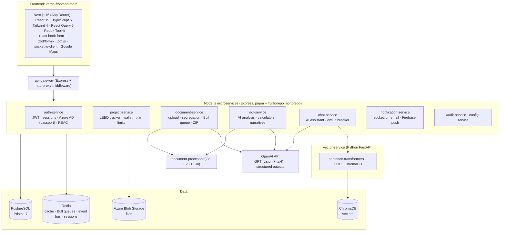
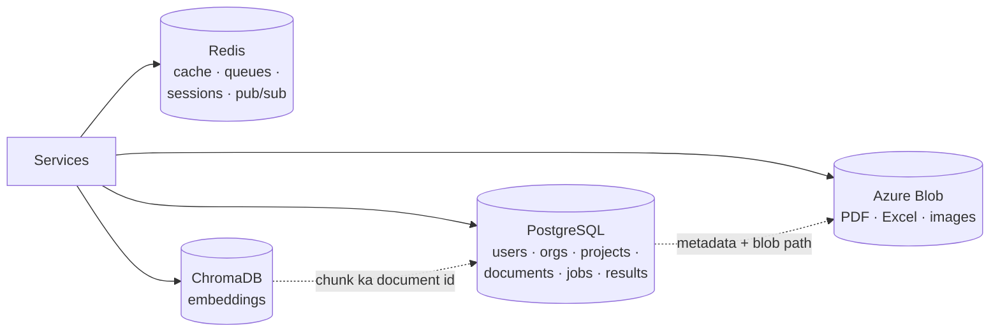
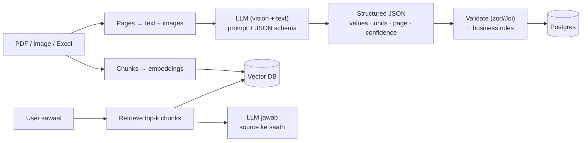

# VERDE: Pro-level SDE-1 Full Stack Developer ke liye skills

> **Ye document kis liye hai:** VERDE project par kaam karne wale (ya join karne wale) full stack developer ke liye. Isme likha hai ki is project mein **kaunsi technology kahan use hoti hai**, ek **pro-level SDE-1** ko usme kitna aana chahiye, aur **job market mein uski demand** kaisi hai.
> **Aadhar:** tech stack seedha code se nikala gaya hai (`package.json`, `go.mod`, `requirements.txt`, `Jenkinsfile`, Prisma schema). Market demand 2025–26 ke job postings ke aam trend par hai, kisi live survey par nahi.

**Levels ka matlab:**

| Level | Matlab |
|---|---|
| 🔴 **Must** | Iske bina VERDE par roz ka kaam nahi ho sakta. Interview mein pakka poocha jaata hai |
| 🟡 **Good** | Kuch hi hisson mein chahiye; aata ho to aap tez aur bharosemand bante ho |
| 🟢 **Bonus** | SDE-1 se expect nahi, lekin aapko alag dikhata hai (SDE-2 ki taraf) |

---

## 1. VERDE ka tech stack (code se)

| Layer | Technology (VERDE mein) |
|---|---|
| Frontend | Next.js 16 (App Router), React 19, TypeScript, Tailwind CSS 4, TanStack React Query 5, Redux Toolkit + redux-persist, react-hook-form, zod, formik, recharts, framer-motion, pdf.js / react-pdf, socket.io-client, @react-google-maps/api, exceljs, jspdf, docx |
| Backend | Node.js, Express, pnpm workspaces + Turborepo, shared packages (`@leed-ai/database`, `errors`, `logger`, `tracing`, `event-bus`, `validators`), Joi / express-validator, JWT, passport-azure-ad, Bull (Redis queues), node-cron, opossum (circuit breaker), socket.io |
| Go service | Go 1.25, Gin, go-redis, excelize, OpenTelemetry |
| Python service | FastAPI, Pydantic, PyTorch, sentence-transformers, OpenAI CLIP, ChromaDB, PyMuPDF, langchain-text-splitters, tiktoken |
| Database | **PostgreSQL** (Prisma 7 ORM), **Redis**, **ChromaDB** (vector), **Azure Blob Storage** (files); MongoDB sirf purane migration scripts mein (`tools/pg-migration`) |
| AI | OpenAI SDK (GPT text + vision, multi-page PDF), structured JSON extraction, gpt-tokenizer, embeddings, CLIP image embeddings, tesseract.js |
| Documents | pdf-lib, pdf-parse, pdfjs-dist, pdf2pic / poppler, sharp, canvas, mammoth (Word), exceljs / xlsx / jszip (.xlsm calculators), dxf-parser (CAD), LibreOffice (conversion), archiver / adm-zip |
| Integrations | Google Drive (googleapis), OneDrive, Google Maps, GTFS transit data, SendGrid / Azure Communication Email / nodemailer, Firebase push |
| DevOps | Docker, Kubernetes, Helm, Jenkins, Azure Container Registry, Nginx ingress |
| Observability | OpenTelemetry (Node + Go), winston + daily-rotate logs, morgan |
| Testing | Jest + supertest (sirf auth-service mein); frontend mein test setup nahi hai |

---

## 2. Market demand ek nazar mein (2025–26)

| Skill area | Market demand | VERDE mein kitna zaroori | SDE-1 level |
|---|---|---|---|
| TypeScript + React | 🔥🔥🔥 Bahut zyada | Poora frontend | 🔴 Must |
| Next.js (App Router) | 🔥🔥🔥 | Poora frontend | 🔴 Must |
| Node.js + Express | 🔥🔥🔥 | 9 services | 🔴 Must |
| PostgreSQL + SQL | 🔥🔥🔥 | Main database | 🔴 Must |
| ORM (Prisma) | 🔥🔥 | Har service | 🔴 Must |
| Redis + queues | 🔥🔥 | Cache, Bull, event bus | 🔴 Must |
| REST API design + auth | 🔥🔥🔥 | Har jagah | 🔴 Must |
| **LLM integration (OpenAI / Claude APIs)** | 🔥🔥🔥 **Sabse tezi se badh rahi** | ocr, document, chat services | 🔴 Must |
| **RAG + vector DB + embeddings** | 🔥🔥🔥 | vector-service, chat | 🟡 Good |
| Docker | 🔥🔥🔥 | Har service | 🔴 Must |
| Kubernetes / Helm | 🔥🔥 | Deployment | 🟡 Good |
| Cloud (Azure / AWS) | 🔥🔥🔥 | Azure Blob, ACR, AKS | 🟡 Good |
| CI/CD | 🔥🔥 | Jenkins | 🟡 Good |
| Testing (unit, API, E2E) | 🔥🔥 | Bahut kam hai, sabse badi kami | 🔴 Must |
| Security (OWASP, multi-tenant) | 🔥🔥 | IDOR jaise asli bugs hain | 🔴 Must |
| Python (FastAPI) | 🔥🔥🔥 (AI ki wajah se) | vector-service | 🟡 Good |
| Go | 🔥🔥 | document-processor | 🟢 Bonus |
| Observability (OpenTelemetry) | 🔥🔥 | Tracing package | 🟡 Good |
| AI coding tools (Claude Code, Copilot, Cursor) | 🔥🔥🔥 Ab expect kiya jaata hai | Roz ka kaam | 🔴 Must |

---

## 3. Fundamentals (har cheez ki neev)

| Skill | Level | Kya aana chahiye |
|---|---|---|
| **JavaScript (ES2023+)** | 🔴 | Closures, `this`, prototypes, event loop, microtask vs macrotask, Promises, `async/await`, error handling, modules (ESM vs CommonJS; VERDE backend CommonJS hai) |
| **TypeScript** | 🔴 | Types vs interfaces, generics, union / discriminated union, narrowing, utility types (`Partial`, `Pick`, `Record`), `unknown` vs `any`, zod se runtime types |
| **DSA** | 🔴 | Arrays, strings, hashmap, two pointers, sliding window, stack/queue, trees, graphs (BFS/DFS), heaps, basic DP. SDE-1 interviews mein LeetCode easy–medium |
| **CS basics** | 🔴 | HTTP/1.1 vs 2, HTTPS/TLS, DNS, cookies vs tokens, CORS, caching headers, processes vs threads, OS memory basics |
| **Git** | 🔴 | Branch, rebase vs merge, conflict resolve, PR review, `git bisect`, achhe commit messages |
| **Code padhna** | 🔴 | Bade codebase mein flow trace karna (VERDE: ek click → frontend → gateway → service → DB → queue → AI) |

---

## 4. Frontend

| Skill | Level | VERDE mein kahan | Kya aana chahiye |
|---|---|---|---|
| **React 19** | 🔴 | Saare components | Hooks (`useState`, `useEffect`, `useMemo`, `useCallback`, `useRef`), re-render kab hota hai, keys, controlled forms, custom hooks, context, error boundaries, Suspense |
| **Next.js 16 App Router** | 🔴 | `app/` folder | Server vs Client Components, layouts, route groups, dynamic routes, middleware (auth redirect), `loading`/`error` files, env variables (`NEXT_PUBLIC_*`), build aur deploy |
| **Server state: React Query** | 🔴 | API calls, polling (segregation banner har 3 s) | `useQuery`, `useMutation`, query keys, invalidation, `staleTime`, optimistic updates, polling, retry |
| **Client state: Redux Toolkit** | 🟡 | Auth, user, permissions (redux-persist) | Slices, selectors, kab Redux aur kab React Query |
| **Forms** | 🔴 | Project wizard, credit forms | react-hook-form + zod validation, error messages, multi-step forms |
| **Tailwind CSS 4** | 🔴 | Poori styling | Responsive design, dark mode, component patterns |
| **Performance** | 🟡 | AnalyticsV2Modal (~5900 lines), lambi lists | Code splitting, `React.memo`, virtualization (`@tanstack/react-virtual`), bade components todna, Lighthouse, Core Web Vitals |
| **PDF / documents UI** | 🟡 | Markup viewer, preview | pdf.js rendering, canvas par annotations, coordinates, zoom |
| **Realtime** | 🟡 | Notifications, job progress | socket.io-client, reconnect, polling vs websockets |
| **Maps** | 🟢 | Add Project address, LT analysis | Google Maps Places autocomplete, markers, geocoding |
| **Accessibility** | 🟡 | Har jagah | Semantic HTML, keyboard navigation, ARIA, contrast |
| **Frontend testing** | 🔴 | **Abhi zero tests** | Vitest/Jest + React Testing Library, Playwright E2E |

---

## 5. Backend

| Skill | Level | VERDE mein kahan | Kya aana chahiye |
|---|---|---|---|
| **Node.js + Express** | 🔴 | 9 services | Middleware chain, routers, error middleware, async errors, streams (badi files), `multer` uploads, graceful shutdown |
| **REST API design** | 🔴 | Saari services | Resource naming, status codes, pagination, filtering, idempotency, versioning, **ek jaisa error format** (VERDE mein ye kami hai) |
| **Validation** | 🔴 | Joi, express-validator, zod | Har input validate karna, server ko kabhi trust na karna ki frontend ne check kiya |
| **Authentication** | 🔴 | auth-service | JWT (access + refresh), sessions (connect-redis), bcrypt, OAuth2 / OIDC (Azure AD via passport), token expiry aur revoke |
| **Authorization / RBAC** | 🔴 | Roles + permissions (`repository: upload`, `segregation: review`) | Permission checks backend par, org/project scope, Super Admin vs Company Admin |
| **Microservices** | 🔴 | api-gateway + services | Gateway / reverse proxy, service-to-service calls, timeouts, retries, circuit breaker (opossum), shared packages, kab microservice aur kab monolith |
| **Background jobs / queues** | 🔴 | Bull queues (segregation, analysis), node-cron | Job lifecycle, retries + backoff, idempotent jobs, dead jobs, concurrency, pause/resume (VERDE mein yahi bugs hain), job ID reuse ki galti |
| **Event-driven** | 🟡 | `@leed-ai/event-bus` (Redis) | Pub/sub, events vs commands, at-least-once delivery |
| **File handling** | 🔴 | Upload, Azure Blob, SAS URLs | Streaming upload, size/type limits, content hash (duplicate), signed URLs, virus scan |
| **Document processing** | 🟡 | ocr-service, document-service, Go processor | pdf-lib (split/merge), pdf-parse, sharp (images), mammoth (Word), exceljs/jszip (.xlsm cells), LibreOffice conversion |
| **Monorepo** | 🟡 | pnpm workspaces + Turborepo | Workspace packages, `turbo run`, shared code versioning |
| **Python (FastAPI)** | 🟡 | vector-service | Async endpoints, Pydantic models, virtualenv, basic PyTorch inference |
| **Go** | 🟢 | document-processor | Goroutines, channels, Gin handlers, error handling, excelize |

---

## 6. Databases (sabse zaroori hissa)

### 6.1 PostgreSQL 🔴 Must (VERDE ka main DB)

| Topic | Kya aana chahiye | VERDE mein example |
|---|---|---|
| SQL | `JOIN` (inner/left), `GROUP BY`, `HAVING`, subquery, CTE (`WITH`), window functions (`ROW_NUMBER`, `RANK`) | Credit-wise documents ginti, latest analysis run per credit |
| Schema design | Normalization (1NF–3NF), kab denormalize, foreign keys, unique constraints, enums | Org → Project → Credit → Document |
| Indexes | B-tree, composite index ka column order, partial index, `EXPLAIN ANALYZE` padhna | `(projectId, creditCode)` par queries |
| Transactions | ACID, isolation levels, row locks (`SELECT … FOR UPDATE`), deadlock | Wallet credits **hold → settle** |
| JSONB | Kab JSON column, kab alag table; JSONB index (GIN) | AI analysis results, extraction data |
| Multi-tenancy | Har query mein `organizationId` filter, Row Level Security ka concept | VERDE mein **IDOR bug**: job ID se doosre org ka data |
| Migrations | Safe migration (pehle column add, phir backfill, phir constraint), rollback | `tools/pg-migration` (Mongo → Postgres) |
| Performance | N+1 query, connection pooling, pagination (offset vs cursor) | Lambi document lists |
| Backup / restore | `pg_dump`, point-in-time recovery ka concept | MVP: "backups can be restored" (abhi tooling nahi) |

### 6.2 Prisma ORM 🔴 Must

- `schema.prisma`, relations, `include` / `select`, `prisma migrate dev` vs `deploy`, `prisma generate`.
- `$transaction`, raw SQL (`$queryRaw`) kab, N+1 se bachna.
- Prisma kab dheema hai aur kab seedha SQL likhna behtar hai.

### 6.3 Redis 🔴 Must

| Use | VERDE mein |
|---|---|
| Cache (TTL, invalidation) | Folder listings, job status, run history (120 s cache) |
| Queues | **Bull** (segregation, analysis jobs) |
| Sessions | connect-redis (auth-service) |
| Pub/sub | `@leed-ai/event-bus`, socket.io events |
| Rate limiting / locks | "ek project, ek job" jaisi rules (`SET NX`) |

Data types (string, hash, list, set, sorted set), TTL, persistence (RDB/AOF) ka basic idea.

### 6.4 Vector database aur embeddings 🟡 Good (AI ke liye bahut demand)

| Topic | Kya aana chahiye |
|---|---|
| Embeddings | Text ko vector banana (sentence-transformers, OpenAI embeddings), images ke liye CLIP |
| Similarity | Cosine similarity, top-k search, metadata filter (jaise `projectId`) |
| ChromaDB | Collections, `add`, `query`, metadata filtering (VERDE vector-service) |
| Doosre options (market) | **pgvector** (Postgres ke andar hi vectors; bahut popular), Pinecone, Qdrant, Weaviate, Azure AI Search, Elasticsearch/OpenSearch (hybrid search) |
| Chunking | Document ko tukdon mein todna (size, overlap), `langchain-text-splitters`, tiktoken se token count |

### 6.5 Object storage 🔴 Must

Azure Blob (VERDE) / AWS S3: containers, blob paths, SAS / pre-signed URLs, streaming upload/download, lifecycle rules, kabhi bhi file DB mein na rakhna, sirf path rakhna.

### 6.6 MongoDB 🟢 Bonus

VERDE ab Postgres par hai; Mongo sirf purane migration scripts mein. Document DB ka concept aur SQL vs NoSQL ka farak interview mein poocha jaata hai, isliye basic samajh rakhein.

---

## 7. AI / LLM engineering (VERDE ka dil, aur market ki sabse badi demand)

VERDE ka main kaam AI se hota hai: documents padhna (OCR / vision), credit batana (classification), values nikalna (extraction), analysis, narratives aur chat.

| Skill | Level | VERDE mein kahan | Kya aana chahiye |
|---|---|---|---|
| **LLM APIs** | 🔴 | `openai` SDK (ocr, document, chat services) | Chat/Responses API, system vs user prompts, temperature, max tokens, streaming, model choice (sasta vs strong). Ek se zyada providers ka idea (OpenAI, Anthropic Claude, Google Gemini, Azure OpenAI) |
| **Structured outputs** | 🔴 | `extractionSchema.js`, classification JSON | JSON schema / function calling, output validate karna, galat JSON par retry |
| **Prompt engineering** | 🔴 | Segregation aur analysis prompts | Clear instructions, few-shot examples, rules (jaise "cover page kisi credit ko nahi"), prompt versioning, prompts ko code ki tarah review karna |
| **Vision / multimodal** | 🔴 | Scanned PDF, drawings (GPT vision) | Page ko image banana (DPI, size), `detail` setting, multi-page batches, kharcha vs quality |
| **Tokens aur cost** | 🔴 | gpt-tokenizer, wallet credits, AI usage dashboard | Token counting, context window, cost per call, batching, caching (prompt caching), usage track karna |
| **Reliability** | 🔴 | Bull retries, opossum circuit breaker | Rate limits (429), timeouts, exponential backoff, fallback model, idempotency |
| **RAG** | 🟡 | chat-service + vector-service | Chunking → embedding → retrieve → answer with citations; hybrid search (keyword + vector); reranking |
| **Evaluation** | 🟡 | `tools/analysis-ab` (A/B analysis) | Golden test set, accuracy measure karna, regression pakadna jab prompt badle. VERDE ka MVP gap: "results match independently verified examples" |
| **Hallucination control** | 🔴 | Verdict LLM ka hai, calculator nahi (MVP gap) | Kab LLM se faisla na karwayein: **hisaab code se**, LLM sirf extraction; confidence thresholds; human review |
| **Agents / tool use** | 🟢 | (Abhi nahi) | Function calling se tools chalana, multi-step agents, MCP (Model Context Protocol) |
| **Security for AI** | 🟡 | User documents AI ko jaate hain | Prompt injection, PII, data leakage between tenants, output ko trust na karna |
| **Classic ML basics** | 🟢 | CLIP, sentence-transformers | Embeddings kya hain, cosine similarity, model inference (PyTorch) |

> **VERDE ka sabse bada sabak:** LLM ko values **nikalne** do, lekin **calculation aur pass/fail** code mein karo (formulas, thresholds). MVP document ke Area 3 ke dono "Not met" isi wajah se hain.

---

## 8. DevOps, Cloud aur Observability

| Skill | Level | VERDE mein | Kya aana chahiye |
|---|---|---|---|
| **Docker** | 🔴 | Har service ka `Dockerfile` (dev, uat) | Dockerfile likhna, multi-stage build, image size kam karna, `docker compose`, volumes, networks, logs. (Disk 100% bharna yahin se hua tha: `docker system df`, `prune`) |
| **Kubernetes** | 🟡 | AKS, Helm chart (`verde-chart`) | Pod, Deployment, Service, Ingress, ConfigMap, Secret, `kubectl logs/describe`, rolling update |
| **Helm** | 🟢 | `values.yaml` | Chart values, environment-wise config |
| **CI/CD** | 🟡 | Jenkins, ACR | Pipeline stages: build → test → image push → deploy; GitHub Actions bhi market mein bahut |
| **Cloud (Azure)** | 🟡 | Blob Storage, ACR, AKS, Azure AD, Communication Email | Core services; AWS ke equivalents (S3, ECR, EKS, Cognito, SES) ka naam aur farak |
| **Nginx / reverse proxy** | 🟡 | Ingress, Cloudflare (52x errors) | Timeouts, body size limits, 502/504/526 errors ka matlab |
| **Config / secrets** | 🔴 | `.env` har service mein | Secrets kabhi git mein nahi, env per environment, Key Vault concept |
| **Logging** | 🔴 | winston, morgan | Structured (JSON) logs, log levels, correlation/request ID |
| **Tracing** | 🟡 | OpenTelemetry (Node + Go) | Trace, span, ek request ka poora safar services ke beech dekhna |
| **Monitoring** | 🟢 | Job monitor dashboard | Metrics, alerts, Grafana/Datadog ka basic |

---

## 9. Security (VERDE ke asli bugs ke saath)

| Topic | Level | VERDE mein example |
|---|---|---|
| **IDOR / broken access control** (OWASP #1) | 🔴 | Segregation job ID se doosre org ka job khul sakta hai |
| **Multi-tenant isolation** | 🔴 | Har query mein org/project scope; suspend ke baad token 24 ghante chalta hai |
| **AuthN/AuthZ** | 🔴 | Backend par permission check, frontend par sirf UI hide karna kaafi nahi |
| **File upload security** | 🔴 | Type/size check server par, virus scan (abhi nahi), file naam sanitize |
| **Input validation, injection** | 🔴 | Joi/zod; Prisma raw queries mein parameters |
| **Secrets** | 🔴 | API keys `.env` mein, logs mein kabhi nahi |
| **Unauthenticated endpoints** | 🔴 | Usage ingestion endpoints bina login (MVP Area 7) |
| **CORS, Helmet, rate limiting** | 🟡 | `helmet`, `cors` har service mein |
| **AI security** | 🟡 | Prompt injection, PII |

---

## 10. Testing aur code quality

| Skill | Level | VERDE mein | Kya aana chahiye |
|---|---|---|---|
| **Unit tests** | 🔴 | Sirf auth-service mein Jest | Jest / Vitest, mocking, pure functions test karna (jaise split decision, confidence rules) |
| **API / integration tests** | 🔴 | supertest (auth-service) | DB ke saath test (test container ya test DB), auth ke saath endpoints |
| **E2E tests** | 🟡 | Nahi hain | Playwright: upload → segregation → review flow |
| **AI tests** | 🟡 | `analysis-ab` | Golden documents par expected credits/values |
| **Linting / formatting** | 🔴 | ESLint, Prettier | Pre-commit hooks |
| **Code review** | 🔴 | PRs | Chhote PR, clear description, edge cases sochna |
| **Debugging** | 🔴 | Logs + traces | Reproduce → isolate → fix; Chrome DevTools, Node inspector, network tab |

---

## 11. System design (SDE-1 level)

SDE-1 se poora distributed system design expect nahi hota, lekin ye samajhna chahiye. Har topic VERDE mein maujood hai:

| Topic | VERDE ka example |
|---|---|
| Client → gateway → services | api-gateway + 9 services |
| Async processing | Upload → Bull queue → worker → status polling / socket |
| Caching | Redis, React Query |
| File storage design | Blob mein file, Postgres mein metadata |
| Idempotency aur retries | Segregation retry saari files dobara chalata hai (galti) |
| Rate limits aur quotas | Wallet credits, plan limits, "ek project ek job" |
| Multi-tenancy | Org → Project scoping |
| AI pipeline design | Extract → validate → calculate → review |
| Search | Naam search vs full-text vs vector search |

**Practice sawaal:** "Design karo: bulk document upload + AI classification system, 250 files, 750 MB, progress bar, pause/resume, cost limit." (Ye VERDE ka segregation hi hai.)

---

## 12. Integrations

| Integration | Level | Kya aana chahiye |
|---|---|---|
| OAuth2 third-party (Google Drive, OneDrive / Microsoft Graph) | 🟡 | Consent flow, refresh tokens, scopes |
| Email (SendGrid, Azure Communication Email, nodemailer) | 🟡 | Templates (handlebars), retries |
| Push (Firebase) | 🟢 | Device tokens |
| Google Maps / Places | 🟢 | Autocomplete, geocoding |
| Open data (GTFS transit) | 🟢 | Bade data files parse karna |
| Excel automation (.xlsm) | 🟡 | Cells likhna, formulas, dropdown (data validation) values; VERDE ke calculator bugs isi mein hain |

---

## 13. Soft skills aur kaam karne ka tareeka

| Skill | Kyun |
|---|---|
| **AI coding tools** (Claude Code, GitHub Copilot, Cursor) | 2026 mein ye basic expectation hai. Lekin AI ka code samajh kar, review karke, test karke merge karna |
| **Documentation** | Functional + technical docs (jaise is folder ke MD files) |
| **Requirements samajhna** | MVP PDF ki "acceptance criteria" ko code tasks mein badalna |
| **Domain knowledge** | LEED basics: categories, credits, prerequisites, typology, v4 vs v4.1. Domain samjhe bina AI prompts aur calculators theek nahi ho sakte |
| **Estimation aur communication** | S/M/L effort batana, blockers jaldi batana |
| **Ownership** | Bug ka root cause dhoondhna, sirf symptom nahi |

---

## 14. Self-check: kya aap pro-level SDE-1 ho?

Har line par ✅ ya ❌ lagaiye.

**Frontend**
- [ ] Next.js App Router mein server aur client component ka farak samjha sakte ho
- [ ] React Query se polling, mutation aur cache invalidation kar sakte ho
- [ ] react-hook-form + zod se validated multi-step form bana sakte ho
- [ ] 5000-line component ko chhote components aur hooks mein tod sakte ho

**Backend**
- [ ] Express mein validation, auth, permission aur ek jaisa error format wala endpoint likh sakte ho
- [ ] Bull queue job bana sakte ho jo retry, pause aur resume theek se kare
- [ ] Badi file streaming se Blob mein upload kar sakte ho

**Database**
- [ ] `EXPLAIN ANALYZE` padh kar sahi index laga sakte ho
- [ ] Wallet "hold → settle" ko transaction aur lock ke saath likh sakte ho
- [ ] Har query mein tenant scope check karte ho (IDOR nahi)
- [ ] Safe migration (zero downtime) likh sakte ho

**AI**
- [ ] LLM se JSON schema ke saath structured data nikal kar validate kar sakte ho
- [ ] Token cost calculate kar sakte ho aur sasta model kab chunna hai bata sakte ho
- [ ] Ek simple RAG (chunk → embed → vector DB → answer with source) bana sakte ho
- [ ] 20 golden documents par prompt ki accuracy measure kar sakte ho

**DevOps aur quality**
- [ ] Service ka Dockerfile likh kar `docker compose` se local chala sakte ho
- [ ] `kubectl logs` se production issue dhoondh sakte ho
- [ ] Apne kaam ke liye unit + API tests likhte ho

**15+ ✅ = pro-level SDE-1.** 10–14 = SDE-1. 10 se kam = pehle Must wale items.

---

## 15. 12-hafte ka learning plan (VERDE ke asli kaam ke saath)

Har hafte ek concept, aur VERDE ka ek asli gap jo usse theek hota hai (gaps [VERDE_MVP_vs_Code.md](VERDE_MVP_vs_Code.md) se).

| Hafta | Seekhna | VERDE par practice |
|---|---|---|
| 1 | Codebase setup, Docker, monorepo | Local par saari services + frontend chalana |
| 2 | Next.js + React Query | Categories ko guideline order mein dikhana (page 31); "Overall score" label (page 48) |
| 3 | Forms + Google Maps | Add Project mein Maps address form tak pass karna (page 32) |
| 4 | Postgres + Prisma, indexes | Run history query theek karna (page 39) |
| 5 | Security / multi-tenancy | Segregation job IDs par org check (IDOR fix) |
| 6 | Testing (Jest, supertest, Vitest) | Split decision aur confidence rules ke unit tests |
| 7 | Bull queues, idempotency | Retry sirf fail hui files chalaye (dobara kharcha nahi) |
| 8 | Excel automation | Outdoor water calculator mein landscaped area cell map karna (page 49) |
| 9 | LLM structured outputs | Calculator dropdown values ki fixed list prompt aur validation mein (pages 50, 60–63) |
| 10 | AI evaluation | 20 golden documents par segregation accuracy test; auto-approve seema 55% → 75–80% ka asar napna |
| 11 | RAG + vector DB | vector-service + chat-service ka flow samajhna; pgvector ke saath chhota prototype |
| 12 | Observability + Kubernetes | Ek request ko OpenTelemetry trace mein services ke beech follow karna |

---

## 16. Interview prep (SDE-1 full stack, AI-focused companies)

| Round | Topics |
|---|---|
| **DSA** | Arrays, hashing, two pointers, trees, graphs, basic DP (LeetCode easy–medium, ~150 sawaal) |
| **JavaScript / TS** | Event loop, closures, promises, debounce/throttle likhna, generics |
| **React / Next.js** | Re-renders, hooks rules, SSR vs CSR, state management choice, performance |
| **Backend** | REST design, auth (JWT vs session), queues, caching, error handling |
| **Database** | SQL queries (joins, group by, window functions), indexes, transactions, SQL vs NoSQL |
| **AI / LLM** | RAG kaise kaam karta hai, embeddings, hallucination kaise kam karein, token cost, structured output, evaluation |
| **System design (light)** | File upload + processing pipeline, notification system, URL shortener |
| **Project discussion** | VERDE ki ek feature end-to-end samjhana: kya banaya, kya galat hua, kaise theek kiya |

---

## 17. Seekhne ke resources

| Area | Resource |
|---|---|
| React / Next.js | react.dev, nextjs.org/docs (App Router), TanStack Query docs |
| Node.js | nodejs.org docs, "Node.js Design Patterns" (book) |
| PostgreSQL | postgresql.org docs, use-the-index-luke.com, Prisma docs |
| Redis / queues | redis.io docs, Bull / BullMQ docs |
| AI / LLM | OpenAI API docs, Anthropic Claude docs, DeepLearning.AI short courses (RAG, evaluation) |
| Vector DB | pgvector README, ChromaDB docs |
| System design | "Designing Data-Intensive Applications" (book), ByteByteGo |
| Security | OWASP Top 10, OWASP API Security Top 10 |
| DevOps | Docker docs, Kubernetes basics (kubernetes.io tutorials) |
| DSA | NeetCode 150, LeetCode |
