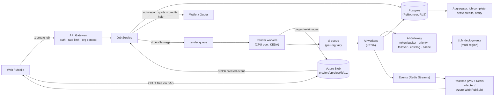

# VERDE Scaling Hiring: Interview Questions with Answers

> **Kis liye:** VERDE ko production scale (**100 clients/organizations, ek saath 1000 projects**) par le jaane ke liye developers hire karna. Ye interviewer ki guide hai: har sawaal ke saath **achhe jawab mein kya hona chahiye**, **red flags**, aur **follow-up**.
> **Aadhar:** sawaal VERDE ke asli architecture aur code mein mili asli problems par based hain (sections 1 aur 9). Candidate ko VERDE ka code nahi dikhana; sirf Section 1.2 ka public-safe summary system design round mein de sakte hain.
> **Jawab Hinglish mein samjhaaye gaye hain.** Candidate English ya Hindi kisi mein bhi de, points wahi dekhne hain.

---

## 0. Kise hire karna hai (role profile)

| Role | Kitne | Zaroori | Kya karega |
|---|---|---|---|
| **Senior Backend / Platform Engineer** (5–8 saal) | 1–2 | Node.js at scale, Postgres, queues, Kubernetes, observability, multi-tenancy | Scaling ka design aur lead; queue/AI pipeline, DB, infra |
| **Backend Engineer, SDE-2** (3–5 saal) | 2 | Node.js + TypeScript, Postgres, Redis/BullMQ, testing, debugging | Fixes aur features: idempotency, tenant checks, APIs, tests |
| **DevOps / SRE** (4+ saal) | 1 | Kubernetes (AKS), Helm, autoscaling, CI/CD, monitoring, Postgres ops, Azure | Infra, load testing, alerts, backups, cost |
| **Full-stack, frontend-heavy SDE-2** (3–5 saal) | 1 | Next.js, React Query, realtime, performance | Polling → realtime, bade components, UX of progress/errors |

**Interview loop (har candidate):**

| Round | Samay | Section | Kaun leta hai |
|---|---|---|---|
| 1. Screening | 30 min | §2 (8–10 quick sawaal) | Koi bhi senior |
| 2. Deep technical | 60 min | §3–§6 (role ke hisaab se 4–5 sawaal) | Tech lead |
| 3. System design | 60 min | §7 (VERDE scaling case) | Tech lead / architect |
| 4. Debugging + code review | 45–60 min | §8 + §9 | Senior engineer |
| 5. Ownership / behavioral | 30 min | §10 | Hiring manager |

**Scoring (har sawaal):** 1 = nahi aata / galat · 2 = textbook, VERDE jaise case par laagu nahi kar paaya · 3 = sahi + trade-offs · 4 = sahi + trade-offs + real experience ka example + khud follow-ups uthaye.
**Hiring bar:** Senior: avg ≥ 3.2 aur system design ≥ 3. SDE-2: avg ≥ 2.8, debugging ≥ 3. Koi bhi "security / multi-tenancy" sawaal par 1 = **no hire**.

---

## 1. Interviewer briefing: VERDE ka asli scale problem

### 1.1 Target load (kaam ke andaaze)

| Cheez | Andaaza (assumption, apne data se badlein) |
|---|---|
| Organizations | 100 |
| Ek saath active projects | 1000 (~10 per org) |
| Ek project ki segregation job | ~80 files, ~15 pages/file → ~1,200 pages |
| Ek project ka credit analysis | ~40–50 credits |
| Peak burst (sab ek saath) | ~1.2M pages render + AI, ~45k credit analyses |
| Upload burst | ~80 files × ~4 MB × 1000 ≈ **~320 GB** |
| Active users | ~2000 (2 per project) |
| Status polling abhi | 2000 clients ÷ 3 s ≈ **~670 req/s sirf status ke liye** |

**Sabse bada bottleneck:** AI provider ki **tokens-per-minute (TPM) / requests-per-minute** limit. Example: 1.2M pages × ~1.8k tokens ≈ **~2 billion tokens**. 10M TPM quota par bhi ~3.5 ghante. Doosra bottleneck: PDF rendering CPU (LibreOffice/Go), teesra: Postgres connections aur writes.

### 1.2 Current architecture (candidate ko ye summary de sakte hain)

- Frontend: Next.js 16, React Query, status polling har 3 s.
- API gateway (Express) → 9 Node.js/Express microservices (auth, project, document, ocr/analysis, chat, notification, audit, config, gateway).
- Go document-processor (PDF → page images/text), Python vector-service (embeddings, ChromaDB).
- PostgreSQL (Prisma ORM, ~59 models, sab services ek shared DB), Redis (cache, Bull queues, sessions, pub/sub), Azure Blob (files).
- OpenAI GPT (text + vision) for classification, extraction, analysis.
- AKS + Helm + Jenkins; OpenTelemetry tracing.

### 1.3 Code review mein mili scaling/reliability problems (interviewer ke liye; candidate ko mat batayein, unse dhoondhwayein)

| # | Problem | Scale par asar |
|---|---|---|
| P1 | Segregation retry **saari files dobara** chalata hai | 1000 projects mein failure = double AI kharcha, duplicate results |
| P2 | Restart/resume par **same Bull jobId** dobara add hota hai, Bull purana ID dekh kar ignore kar deta hai | Jobs "atak" jaate hain |
| P3 | Pause **cooperative nahi**: chalta kaam nahi rukta | Load shedding/cost control nahi ho paata |
| P4 | Worker concurrency `os.cpus()` par based (`segregationWorker.js`) | Pod CPU limit aur node CPUs mein farak → over/under-subscription |
| P5 | notification-service socket.io mein **Redis adapter nahi** | 2+ pods par events sirf kuch users tak pahunchenge |
| P6 | Frontend har 3 s poll | ~670 rps faltu load |
| P7 | Saari services ek shared Postgres, Prisma pools per pod | Pods scale karte hi **connection exhaustion** |
| P8 | Kuch job routes par **org check nahi (IDOR)** | Multi-tenant data leak |
| P9 | Credit analysis 100+ page PDF ke sirf 20 sample pages padhta hai | Scale par cost bachane ka hack, accuracy ka nuksaan |
| P10 | ChromaDB single HTTP server | Vector search ka single point of failure |
| P11 | Wallet/plan limits default **shadow mode** | 100 clients mein koi bhi poora AI quota kha sakta hai |
| P12 | Run history 120 s cache, invalidation nahi | Stale UI |
| P13 | Suspended org ka token ocr-service mein ~24 h chalta hai | Security |
| P14 | Error formats har service mein alag | Debugging aur client handling mushkil |

---

## 2. Screening round (30 min, quick sawaal)

Har sawaal ka jawab 2–3 minute. 10 mein se 7 theek → next round.

**Q2.1 Node.js single-threaded hai. Ek CPU-heavy kaam (jaise 200-page PDF parse) API ke saath ek hi process mein chale to kya hoga? Kya karoge?**
- ✅ Event loop block hoga, saari requests ki latency badhegi, health checks fail ho sakte hain. Fix: CPU kaam ko **worker process/queue** mein (BullMQ worker alag deployment), ya `worker_threads`, ya alag service (VERDE ka Go processor). API sirf enqueue kare.
- 🚩 "Async/await laga do" (async CPU kaam ko non-blocking nahi banata).

**Q2.2 Postgres "too many connections" error aaya jab humne pods 4 se 20 kiye. Kyun?**
- ✅ Har pod ka apna pool (Prisma default ~`num_cpus*2+1`) × pods × services > `max_connections`. Fix: **PgBouncer (transaction pooling)** ya Azure Flexible Server ka built-in PgBouncer, pool size per pod set (`connection_limit`), read replicas, kam services ek DB par.
- 🚩 "max_connections 5000 kar do" (memory per connection, performance girta hai).

**Q2.3 Queue job do baar chal gaya. Kyun ho sakta hai aur kya design karoge?**
- ✅ At-least-once delivery: worker crash/stall, ack se pehle timeout, manual retry. Design: **idempotent steps** (status check, upsert with unique key, "already done" skip), idempotency keys, side effects (billing) ledger mein unique.
- 🚩 "Exactly-once guarantee queue deta hai."

**Q2.4 100 organizations, ek Postgres. Ek org ka data doosre ko na dikhe, kaise guarantee?**
- ✅ Har table mein `org_id`, repository layer har query mein enforce kare, resource lookup `(id, org_id)` se, mismatch = 404; **Row Level Security** extra layer; automated tests (cross-tenant access test har endpoint ke liye); blob paths org-prefixed.
- 🚩 Sirf frontend/UI se chhupana; "JWT mein org hai to kaafi".

**Q2.5 Socket.io app ko 3 pods par chalaya; kuch users ko notifications nahi aa rahe. Kyun?**
- ✅ Event jis pod par emit hua, user doosre pod se connected hai. Fix: **Redis adapter** (`@socket.io/redis-adapter`) ya Redis Streams adapter, sticky sessions (polling fallback ke liye), ya managed (Azure Web PubSub).
- (Ye VERDE ka P5 hai.)

**Q2.6 OpenAI se 429 errors aa rahe hain peak par. Kya karoge?**
- ✅ Exponential backoff + jitter, `Retry-After` respect; **central rate limiter** (token bucket on TPM/RPM) workers ke aage; concurrency limit; per-tenant fairness; quota badhwana / multiple deployments-regions (Azure OpenAI); non-urgent kaam **Batch API**; chhota model jahan ho sake; caching.
- 🚩 Sirf "retry kar do" (retry storm).

**Q2.7 Frontend 2000 users har 3 s status poll karte hain. Problem aur solution?**
- ✅ ~670 rps faltu; DB hits. Fix: WebSocket/SSE push; ya polling ko Redis-cached status + ETag/304 + backoff (3 s → 10 s → 30 s), tab hidden ho to band.

**Q2.8 Horizontal vs vertical scaling; stateless service ka matlab?**
- ✅ Stateless = request ka state pod mein nahi (session Redis/JWT mein, files blob mein, temp files cleanup) → koi bhi pod handle kare → HPA se scale. Vertical ki limit aur cost.

**Q2.9 Cache invalidation ka ek real bug batao jo aapne dekha.**
- ✅ Real example + fix (event-based delete, TTL + versioned keys). Real experience check.

**Q2.10 Kubernetes mein pod OOMKilled ho raha hai PDF processing par. Pehle 3 steps?**
- ✅ `kubectl describe pod` (limits, restarts), memory metrics (peak vs limit), heap/stream usage dekhna (poori file memory mein load?); fix: streaming, page-by-page, per-pod concurrency kam, limit badhana, alag node pool for heavy jobs.

---

## 3. Deep technical: Node.js, queues, workers

**Q3.1 VERDE ka segregation: ek job = 80 files; har file render (CPU) + AI calls (I/O). Worker design kaise karoge ki 1000 jobs ek saath aayein to system na toote aur sab orgs ko fair share mile?**

*Achha jawab:*
- **Fan-out:** job → per-file messages (alag queue), taaki parallelism aur retry file-level par ho.
- **Alag queues alag kaam ke liye:** `render` (CPU-bound, CPU node pool, concurrency ≈ pod ke CPU limit), `ai-calls` (I/O-bound, high concurrency lekin global rate limiter ke peeche), `aggregate`.
- **Fairness:** per-org concurrency cap (VERDE mein `MAX_ORG_CONCURRENCY` hai) + weighted round-robin / per-org queues ya BullMQ Pro groups; chhote jobs ko priority (VERDE mein ≤50 files high priority hai).
- **Backpressure:** queue depth bade to naye jobs "queued" state mein, user ko ETA; admission control (credits + quota).
- **Concurrency config** CPU limit se, `os.cpus()` se nahi (container mein `os.cpus()` node ke saare CPUs dikhata hai, limit nahi) → P4.
- **Autoscaling:** KEDA se queue length par worker pods scale.

*Red flags:* ek hi giant queue with fixed concurrency; "Node cluster mode se ho jayega"; fairness ka zikr nahi.
*Follow-up:* "Ek org ne 5000 files daal di; baaki 99 orgs ka kya?" → per-org cap + priority + quota.

**Q3.2 Job fail hone ke baad "Retry" button saari 80 files dobara chalata hai. Fix design karo.** (P1)

*Achha jawab:*
- `job_files` table: per-file status (`PENDING / RENDERED / CLASSIFIED / DONE / FAILED`), attempts, error_code, result id.
- Retry = sirf `status != DONE` files enqueue. Worker har step se pehle status check (idempotent).
- Results par unique constraint `(job_file_id, credit_code)` + upsert → duplicate review items nahi.
- Billing: per-file ledger entry with unique key → dobara charge nahi.
- UI: "12 failed files retry karein" (sirf wahi).

**Q3.3 BullMQ/Bull mein same `jobId` se job add kiya to kya hota hai? Isse "resume ke baad job kabhi start nahi hua" bug kaise bana?** (P2)

*Achha jawab:* Bull/BullMQ `jobId` ko dedupe ke liye use karta hai: agar us ID ka job queue/Redis mein abhi bhi hai (completed/failed retention ke saath), naya add **ignore** ho jaata hai (koi error nahi). Fix: har attempt ka unique ID (`${jobId}:${attempt}`), ya purana job `remove()` karke add, ya `job.retry()` failed job par; completed/failed retention policy (`removeOnComplete`) samajhna; add ke baad verify karna.
*Red flag:* dedupe behaviour pata hi nahi.

**Q3.4 Pause dabane par chalte jobs nahi rukte. Sahi pause/cancel design?** (P3)

*Achha jawab:* Queue pause sirf naye jobs uthana rokta hai. Job-level: DB/Redis mein `job.state = PAUSING`; worker har file/page batch ke beech check kare (cooperative cancellation, `AbortController` HTTP calls ke liye); in-flight AI call poora hone de ya abort; state `PAUSED` jab saare workers ruk jaayein; resume = pending files dobara enqueue (naye IDs). Cancel = held credits release.

**Q3.5 Long-running job (30–60 min) Kubernetes rolling deploy ke beech mein hai. Kya hoga, kaise bachoge?**

*Achha jawab:* SIGTERM par pod mar jaayega → job stalled → retry from scratch (agar idempotent design nahi). Fix: `terminationGracePeriodSeconds`, SIGTERM handler: naya kaam lena band, current file khatam karke checkpoint; kaam chhote units mein (per-file, per-page batch) taaki loss kam; stalled-job detection; ya long tasks ke liye **Kubernetes Job per task** (VERDE ocr-service mein `k8sJobLauncher.js` option hai): trade-off pod startup time vs isolation.

**Q3.6 Event loop lag kaise napoge aur production mein kaise monitor karoge?**

*Achha jawab:* `perf_hooks.monitorEventLoopDelay`, OpenTelemetry metrics, Prometheus `nodejs_eventloop_lag`; alert p99 > 100 ms; CPU profiling (`--cpu-prof`, clinic.js, 0x); badi JSON (`JSON.parse` of 50 MB AI output) ek common culprit → streaming parse (`stream-json`, VERDE ocr-service mein hai).

**Q3.7 Badi files (500 MB) upload: API pod ke through ya seedha blob mein?**

*Achha jawab:* Seedha blob par **SAS / pre-signed URL** (block blob, chunked, resumable); API sirf metadata + verify (size, hash, type) after upload event (Event Grid / complete call); API pods par memory/bandwidth nahi; `multer` memory storage kabhi nahi. Virus scan async step.

**Q3.8 Microservices ke beech sync HTTP calls; ek service slow ho gayi to cascade failure. Kaise rokoge?**

*Achha jawab:* Har call par timeout, retries sirf idempotent + backoff + budget, **circuit breaker** (VERDE chat-service mein opossum), bulkheads (alag pools), fallback; long kaam async events par; deadline propagation; OpenTelemetry se dependency map.

---

## 4. Deep technical: PostgreSQL at scale

**Q4.1 1000 projects ek saath analysis likh rahe hain; Postgres CPU 95%. Debug kaise karoge?**

*Achha jawab (step by step):*
1. `pg_stat_activity` (kya chal raha, waits, locks), `pg_stat_statements` (top queries by total time).
2. Top query ka `EXPLAIN (ANALYZE, BUFFERS)`: seq scan? missing index? bad join?
3. N+1 pattern (Prisma loops) → batch/`include`/`IN`.
4. Badi JSONB writes (analysis results) → TOAST, write amplification; kya har field JSONB mein chahiye?
5. Connection count + pool; idle in transaction.
6. Short-term: index (`CONCURRENTLY`), query fix, pool limit; long-term: read replicas for reads, partitioning, heavy blobs ko object storage mein.
*Red flag:* seedha "bada server le lo" ya "MongoDB par chalo".

**Q4.2 Prisma + Kubernetes: 9 services × 5–20 pods. Connection strategy?** (P7)

*Achha jawab:* Total connections budget banana (e.g. DB 500 max → per service quota → per pod `connection_limit`); **PgBouncer transaction mode** (Prisma `pgbouncer=true`, prepared statements ka dhyan); workers aur API ke alag pools; long transactions avoid; read replica ke liye alag datasource (Prisma read replicas extension).

**Q4.3 Multi-tenant: shared schema + `org_id` vs schema-per-tenant vs DB-per-tenant. 100 clients ke liye kya aur kyun?**

*Achha jawab:* 100 clients ke liye **shared schema + org_id + RLS** sabse practical (ek migration, kam ops); bade/enterprise clients ke liye "silo" option baad mein (DB-per-tenant) agar compliance/data residency maange. Noisy neighbour: per-tenant quotas, query timeouts. `org_id` har index ka leading column jahan tenant-scoped queries hain. Trade-offs clearly.

**Q4.4 Row Level Security kaise lagaoge Prisma ke saath, aur kya pitfalls?**

*Achha jawab:* `ALTER TABLE ... ENABLE ROW LEVEL SECURITY`; policy `USING (org_id = current_setting('app.org_id')::uuid)`; har request transaction mein `SET LOCAL app.org_id = ...` (Prisma `$transaction` + `$executeRaw` ya client extension); pitfalls: connection pooling mein `SET` leak (isliye `SET LOCAL` in transaction), table owner RLS bypass karta hai (`FORCE ROW LEVEL SECURITY`), admin/background jobs ke liye alag role, performance (policy predicates indexable hon).

**Q4.5 `analysis_runs` table 50M rows tak pahunch gayi. "Latest run per credit per project" query slow. Kya karoge?**

*Achha jawab:* Composite index `(project_id, credit_code, created_at DESC)`; `DISTINCT ON` / lateral join; ya **denormalized** `latest_run_id` on `project_credits` (write par update); time-based **partitioning** (`created_at` monthly) + purane partitions archive; result JSONB ko alag table/blob mein.

**Q4.6 Zero-downtime migration: `documents` table (20M rows) mein naya NOT NULL column + index chahiye.**

*Achha jawab:* Expand–migrate–contract: (1) nullable column add (fast), (2) app dual-write, (3) batch backfill (chhote batches, throttle), (4) `CREATE INDEX CONCURRENTLY`, (5) `NOT NULL` via `CHECK ... NOT VALID` + `VALIDATE CONSTRAINT`, (6) purana code hatao. Prisma migrate ke saath raw SQL steps; lock timeout set.

**Q4.7 Wallet: 100 orgs, har AI call par credits kaatne hain. 10,000 deductions/minute par contention aur correctness?**

*Achha jawab:* Har call par wallet row update = hot row contention. Better: **hold at job start** (ek transaction), calls ke usage **append-only ledger** mein (no contention), periodic/at-end **settle** (aggregate). Atomic conditional update (`WHERE balance - held >= x`), idempotency key per ledger entry, reconciliation job. Shadow mode (P11) hatana aur real enforcement.

**Q4.8 Backups aur disaster recovery: RPO/RTO kya rakhoge aur kaise test karoge?**

*Achha jawab:* Managed Postgres PITR (e.g. 7–35 din), RPO minutes, RTO < 1 h target; blob storage soft delete + versioning; **restore drill har quarter** (staging mein restore + app chala ke verify); cross-region replica agar zaroori. "Backup hai" kaafi nahi, restore tested hona chahiye.

---

## 5. Deep technical: AI pipeline at scale

**Q5.1 1000 projects × ~1,200 pages = 1.2M pages ek saath. AI cost aur time ka estimate aur plan?**

*Achha jawab:*
- Estimate: pages × tokens/page (image tokens + prompt + output) → total tokens; TPM quota se divide → minimum time; cost = tokens × price.
- Plan: (1) **cheap first pass**: digital PDF ka text extract (vision nahi), sirf scanned/drawing pages vision par; (2) chhota model classification ke liye, bada sirf mushkil cases; (3) **dedupe** same file hash + prompt version → cached result; (4) Batch API non-urgent ke liye (sasta, slow); (5) multiple deployments/regions, quota increase; (6) per-org fair share; (7) user ko realistic ETA.
- Accuracy ko cost ke liye na bechna: VERDE ka "20 sample pages" (P9) ek trade-off hai jise measure karna chahiye, chupchaap nahi.

**Q5.2 Central "AI gateway" design karo jo saari services (segregation, analysis, chat) use karein.**

*Achha jawab:* Ek internal service/library: provider abstraction, **global token bucket** (TPM/RPM per deployment, Redis-based), per-tenant budgets aur concurrency, priority lanes (interactive chat > batch analysis), retries with backoff + jitter, failover deployment/model, request/response logging (tokens, cost, latency, prompt version, org), caching, PII redaction, circuit breaker. Metrics: 429 rate, queue wait time, cost/org.

**Q5.3 AI output galat/invalid JSON aata hai 2% cases mein. 1.2M pages par ye 24k failures. Kya karoge?**

*Achha jawab:* Strict structured outputs/JSON schema; schema validation; 1 retry with validation error; phir fallback model; phir `FAILED(reason=AI_INVALID)` + manual review queue; ye failures **file-level** hon, job fail na ho; dashboard per prompt version; eval set mein ye cases add.

**Q5.4 Prompt/model badalne par 1000 projects ke results kaise safe rakhoge?**

*Achha jawab:* Prompt versioning (DB mein har result ke saath version), **offline eval** golden set par (accuracy, cost, latency), canary (5% orgs), feature flag per org, rollback; purane results re-run sirf opt-in; A/B tooling (VERDE `tools/analysis-ab`).

**Q5.5 Vector search (ChromaDB single server) 100 orgs ke liye. Scale aur isolation?** (P10)

*Achha jawab:* Single node = SPOF + memory limit. Options: **pgvector** (same Postgres, `org_id` filter, HNSW, backups ek jagah) agar vectors ~ten millions tak; ya managed (Azure AI Search, Qdrant/Pinecone) for scale + hybrid search. Tenant isolation: metadata filter mandatory (ya collection/namespace per org); embeddings re-index pipeline (model change), backup.

**Q5.6 Interactive chat aur background analysis same AI quota share karte hain. Peak par chat slow ho gaya. Fix?**

*Achha jawab:* Priority lanes / reserved quota (alag deployment) for interactive; background ko throttle (backpressure), batch API; SLO alag (chat p95 < 5 s TTFT; batch hours).

---

## 6. Deep technical: Kubernetes, infra, observability, frontend

**Q6.1 VERDE ko AKS par 100 clients ke liye: kaunse workloads alag node pools mein aur kyun?**

*Achha jawab:* (1) API/gateway pool (general), (2) **CPU-heavy render pool** (Go processor + LibreOffice; higher CPU, maybe spot nodes with care), (3) AI worker pool (I/O, more pods, less CPU), (4) system pool. Requests/limits sahi; HPA for APIs (CPU/RPS), **KEDA** for workers (queue length); PodDisruptionBudgets; anti-affinity; cluster autoscaler.

**Q6.2 Autoscaling ke signals: CPU kaafi hai?**

*Achha jawab:* APIs: CPU + RPS/latency. Workers: **queue depth / oldest message age** (KEDA Redis/BullMQ scaler), kyunki AI workers I/O wait mein CPU kam use karte hain. Scale limits AI quota aur DB connections se bandhe hon (zyada pods = zyada 429 aur connections).

**Q6.3 Observability: 1000 jobs mein ek project ka job "atka" hai. Kaise dhoondhoge? Kya dashboards/alerts chahiye?**

*Achha jawab:* Har job/file par `jobId`, `orgId`, `projectId` labels logs + traces mein (OpenTelemetry already hai); job state machine timestamps DB mein; dashboard: queue depth, oldest job age, per-state counts, failures by reason, AI 429/latency, cost/org; alerts: job progress no-change > 15 min, DLQ growth, error rate. Runbook link alert mein.

**Q6.4 SLOs kya define karoge VERDE ke liye?**

*Achha jawab (examples):* API availability 99.9%; p95 API latency < 500 ms (non-AI); segregation job: 95% jobs ≤ 80 files 30 min mein complete; analysis per credit p95 < 3 min; zero cross-tenant incidents; error budget policy.

**Q6.5 Load testing kaise karoge release se pehle?**

*Achha jawab:* k6 / Artillery / Locust: realistic scenario (login, upload via SAS, start job, poll/WS, review); **AI provider ko mock** (latency + 429 simulate) taaki kharcha na ho aur limits test hon; separate staging with prod-like data volume; ramp to 1000 concurrent projects; watch DB, queue, pods; find knee point; soak test (8 h) for leaks.

**Q6.6 (Frontend) 2000 users, har ek ke paas progress banner + analysis modal (~5900 line component). Scale par frontend kya sudhaaroge?**

*Achha jawab:* Polling → SSE/WebSocket with fallback polling + backoff; React Query cache sharing/dedupe; bade component ko split + lazy load + virtualization; error boundaries; optimistic UI for review; CDN for static; Next.js caching sahi; RUM (Core Web Vitals) monitoring.

**Q6.7 CI/CD: 9 services + frontend, din mein kai deploys. Safe release?**

*Achha jawab:* Per-service pipelines (affected-only via Turborepo), tests + migrations check, image scan, staging deploy + smoke tests, canary/blue-green, feature flags (VERDE mein abhi feature flags nahi), DB migration backward-compatible pehle, automatic rollback on error-rate spike.

---

## 7. System design round (60 min): "Scale VERDE to 100 orgs × 1000 concurrent projects"

### 7.1 Candidate ko prompt (ye padh kar sunaayein)

> "Hamara SaaS LEED green-building certification ke documents process karta hai. Users project mein bahut saari files (PDF, Word, Excel, CAD, scans) upload karte hain. System har file ke pages render karta hai, AI (LLM vision + text) se classify karta hai ki kaunse pages kis 'credit' ke hain, files ko credit folders mein rakhta hai, phir har credit ka AI analysis chalata hai. Users progress dekhte hain aur kam-confidence results review karte hain.
> Abhi: Node.js microservices, ek PostgreSQL, Redis + Bull queues, Azure Blob, OpenAI, Kubernetes. Target: **100 organizations, ek saath 1000 active projects**, har project ~80 files. Har org ka AI usage unke prepaid credits se limited hai. Design karo ki ye reliably, fairly aur cost-effectively chale."

### 7.2 Achhe jawab ka structure (interviewer checklist)

| Step | Kya dekhna | Score points |
|---|---|---|
| Requirements | Functional: upload, process, progress, review, retry, pause/cancel. Non-functional: tenant isolation, fairness, cost cap, reliability, ETA | Clarifying sawaal poochhe? |
| Estimation | ~1.2M pages, ~2B tokens, ~320 GB burst, ~670 rps polling → **AI quota = bottleneck** pehchaana | Numbers se design drive kiya? |
| Architecture | Direct-to-blob upload; job service; per-file fan-out; alag render vs AI queues; AI gateway; results store; realtime | Saaf diagram |
| Data model | `jobs`, `job_files` (per-file state), `results` (unique keys), ledger | Idempotency ke liye keys |
| Deep dive 1: fairness + cost | Per-org concurrency + token budgets + priority; admission control; held credits | |
| Deep dive 2: reliability | Idempotent steps, file-level retry, stalled detection, graceful shutdown, DLQ | |
| Deep dive 3: DB + connections | PgBouncer, indexes, partitioning, replicas | |
| Realtime | WS/SSE with Redis adapter / managed PubSub; fallback polling with ETag | |
| Observability + SLOs | Queue age, cost/org, alerts | |
| Trade-offs | Accuracy vs cost (sampling), batch vs realtime, auto-approve threshold | Khud bole? |

### 7.3 Model answer (reference)



**Key decisions:**
1. **Upload:** client seedha Blob par SAS se (chunked, resumable). API par bandwidth/memory load nahi. Blob event → `job_files.status = UPLOADED`.
2. **Admission control:** job start par: org ka active-job cap, credits estimate + **hold** (transaction), global queue depth dekh kar ETA. Credits kam → `HELD` (failed nahi).
3. **Fan-out + per-file state machine:** `PENDING → RENDERED → CLASSIFIED → DONE | FAILED(reason)`. Har step idempotent (status check + upsert with unique keys). Retry = sirf non-DONE.
4. **Two queues, two scaling profiles:** render (CPU-bound, concurrency = CPU limit) aur AI (I/O-bound, concurrency AI gateway ke tokens se). KEDA queue length/age par scale, **max replicas AI quota se capped**.
5. **Fairness:** per-org weighted fair queuing (per-org sub-queues + round-robin dispatcher, ya BullMQ groups); interactive (chat/review re-run) ke liye reserved lane.
6. **AI gateway:** Redis token bucket per deployment (TPM/RPM), per-org budget counters, `Retry-After` backoff, failover deployment/region, model routing (cheap classifier → strong model only when needed), result cache by `(sha256, page, promptVersion)`, cost ledger per call.
7. **Cost/accuracy:** digital text pages ke liye vision skip; sampling sirf explicit, measured trade-off; Batch API for overnight re-analysis.
8. **Database:** PgBouncer; `org_id`-leading indexes; RLS; `job_files`/`results` partitioned by month; big AI JSON in blob with pointer; read replica for dashboards.
9. **Realtime:** Redis Streams events → realtime service (Redis adapter) → rooms per project; polling fallback 10–30 s with ETag.
10. **Pause/cancel:** job state checked before each unit; `AbortController` on in-flight calls; release holds.
11. **Observability:** OTel traces with `orgId/jobId`; dashboards (queue age, files/s, 429 rate, cost/org, failures by reason); alerts on stuck jobs.
12. **Security:** IDOR-proof repository layer (`findByIdForOrg`), RLS, short-lived SAS, virus scan, token revocation on org suspend (P13).

**Expected trade-offs candidate ko bolne chahiye:** per-file messages = zyada queue ops lekin behtar retries; fairness vs throughput; batch API sasta lekin slow; RLS = safety lekin pooling complexity; auto-approve threshold = review load vs galat filing.

### 7.4 Follow-up sawaal (time ke hisaab se)
1. "OpenAI region down ho gaya 2 ghante ke liye." → failover deployment, queue me rakho, ETA update, no data loss, held credits safe.
2. "Ek client 10× bada ho gaya (2000 files/project)." → per-org cap, chunked job, priority low, dedicated capacity (paid tier).
3. "Hum 100 → 1000 orgs jaayein to pehle kya tootega?" → AI quota, DB writes/connections, realtime fan-out, blob egress; plan.
4. "Cost per project kaise napoge aur client ko bill kaise?" → ledger per call, aggregates, reconciliation.
5. "Ek bug se 300 projects ke results galat bane. Recovery?" → prompt version se affected results dhoondo, re-run sirf unke (idempotent), users notify, audit.

---

## 8. Debugging scenarios (45 min, 2–3 scenarios)

Candidate ko symptom do; dekho wo **hypothesis → data → fix → prevention** order mein sochta hai ya nahi.

**S8.1 "Monday 10 baje 300 projects ek saath start hue; 40 min baad bhi 0% progress, koi error nahi."**
- Hypotheses: workers down/crashloop; queue paused; jobs dedupe ho kar ignore (same jobId, P2); per-org cap/admission bug; Redis memory full (eviction ne queue keys hataye!); workers ek giant job par atke.
- Data: queue counts (waiting/active/delayed/failed), worker logs, Redis `INFO memory` + eviction policy (queues ke liye `noeviction` chahiye), pod status.
- Prevention: alert on oldest-waiting-age, Redis `noeviction`, add-job verify.

**S8.2 "Kuch users ko dusre org ke project ka naam notification mein dikha."**
- Severity 1 security incident: pehle containment (feature off), phir root cause: notification room naming (`projectId` collision? broadcast to wrong room?), IDOR in API, cache key without `orgId`.
- Achha jawab: incident process (scope, affected tenants, logs, disclosure), fix + cross-tenant tests + cache keys mein orgId.

**S8.3 "AI cost pichhle hafte 3× ho gaya, usage utna nahi badha."**
- Hypotheses: retries saari files dobara (P1); retry storm on 429; cache miss (prompt version change); sampling hata; ek org ka loop; duplicate jobs.
- Data: cost ledger by org/purpose/promptVersion/day; attempts per file.
- Fix + guardrails: per-org daily budget alerts, retry budget.

**S8.4 "Deploy ke baad p95 latency 300 ms → 4 s, sirf document-service."**
- Data: traces (kaunsa span slow), DB `pg_stat_statements` diff, event loop lag, new N+1, missing index on new query, connection pool wait.
- Rollback pehle (mitigate), phir root cause.

**S8.5 "Realtime progress kuch users ko aata hai, kuch ko nahi; refresh par sahi dikhta hai."**
- Socket.io multi-pod without Redis adapter (P5); sticky sessions missing for polling transport; ingress websocket timeout.

**S8.6 "Postgres disk 90%, growth 20 GB/din."**
- AI JSON results JSONB mein, audit logs, dead tuples (autovacuum); fix: big payloads to blob, retention/partition drop, vacuum tuning, alerts.

---

## 9. Code review exercise (20 min)

Candidate ko ye code do (VERDE jaisa, simplified). Pucho: **"Production mein 100 clients ke saath kya problems aayengi?"**

```js
// routes/jobs.js
router.get("/jobs/:jobId", auth, async (req, res) => {
  const job = await prisma.segregationJob.findUnique({ where: { id: req.params.jobId } });
  const files = [];
  for (const f of job.fileIds) {
    files.push(await prisma.jobFile.findUnique({ where: { id: f } }));
  }
  res.json({ job, files });
});

router.post("/jobs/:jobId/retry", auth, async (req, res) => {
  const job = await prisma.segregationJob.findUnique({ where: { id: req.params.jobId } });
  await prisma.segregationJob.update({ where: { id: job.id }, data: { status: "queued" } });
  await queue.add("segregate", { jobId: job.id }, { jobId: job.id });
  res.json({ ok: true });
});

// worker.js
queue.process(require("os").cpus().length * 4, async (bullJob) => {
  const job = await prisma.segregationJob.findUnique({ where: { id: bullJob.data.jobId } });
  for (const fileId of job.fileIds) {
    const buf = await blob.download(fileId);               // poori file memory mein
    const pages = await render(buf);
    for (const p of pages) {
      const r = await openai.chat.completions.create({ /* ... */ });
      await prisma.result.create({ data: { fileId, page: p.n, raw: r } });
      await prisma.wallet.update({ where: { orgId: job.orgId }, data: { balance: { decrement: 1 } } });
    }
  }
  await prisma.segregationJob.update({ where: { id: job.id }, data: { status: "completed" } });
});
```

**Expected findings (jitne zyada, utna achha):**

| # | Problem | Fix |
|---|---|---|
| 1 | **IDOR:** `orgId` check nahi (dono routes) | `findFirst({ where: { id, orgId: req.user.orgId } })` → 404 |
| 2 | `job` null ho to crash (500) | 404 handling |
| 3 | **N+1** queries files ke liye | `findMany({ where: { id: { in: job.fileIds } } })` |
| 4 | Retry: same Bull `jobId` → **dedupe se ignore** | unique attempt ID / remove old |
| 5 | Retry permission check nahi, status check nahi (running job retry?) | state machine guard |
| 6 | Retry **saari files** dobara | per-file status, sirf failed |
| 7 | `os.cpus() * 4` concurrency: container limit nahi dekhta; CPU-bound render + I/O-bound AI ek saath | alag queues, config from limits |
| 8 | Poori file memory mein (`download` buffer) | streaming / page-by-page |
| 9 | Sequential AI calls, koi rate limiter/backoff/timeout nahi | AI gateway, concurrency, retries |
| 10 | `result.create` not idempotent → retry par duplicates | unique `(fileId, page, promptVersion)` + upsert |
| 11 | Raw AI response store (size) | validated fields; raw blob mein |
| 12 | Wallet: har page par hot-row update, no balance check, not idempotent | hold/ledger/settle |
| 13 | Ek file fail = poora job fail; status "completed" bina failures count ke | per-file error handling |
| 14 | Pause/cancel check nahi | cooperative checks |
| 15 | Koi logging/tracing context (`orgId`, `jobId`) nahi | structured logs |

**Score:** 10+ = strong senior, 6–9 = SDE-2 bar, <5 = no.

---

## 10. Ownership / behavioral (30 min)

| Sawaal | Achhe jawab mein |
|---|---|
| "Ek system jo aapne scale kiya: shuruaat mein kya load tha, kya toota, kya kiya, numbers?" | Asli numbers, unka apna role ("I" vs "we"), measurement, trade-offs |
| "Sabse bura production incident jisme aap the." | Calm process: mitigate first, communicate, root cause, blameless postmortem, action items jo sach mein hue |
| "Kab aapne 'abhi scale mat karo' kaha?" | Premature optimization ki samajh; data-driven |
| "Ek decision jo galat nikla." | Honest, seekh |
| "On-call ke baare mein kya sochte ho?" | Runbooks, alerts quality, toil kam karna |
| "Product team ne 2 hafte mein feature maanga, aapko lagta hai scale par tootega." | Trade-off, phased plan, risk likhit mein |
| "Junior ne IDOR wala code merge kar diya. Aap kya karoge?" | Fix + test + process (review checklist, lint/tests), blame nahi |

**Red flags:** sab kuch "we" bina apne role ke; numbers nahi; blame culture; "mere system mein kabhi incident nahi hua".

---

## 11. Optional take-home (4–6 ghante, paid ho to behtar)

**Task:** "Mini document job processor": Node.js + TypeScript + Postgres + Redis (BullMQ), docker-compose.
- `POST /jobs` (files list, orgId from token), per-file processing (fake AI call with random latency + 10% 429 + 5% invalid JSON).
- Requirements: per-file state, idempotent retries (sirf failed files), per-org concurrency cap, global rate limit (e.g. 20 calls/s), pause/cancel, `GET /jobs/:id` org-scoped, tests (incl. cross-tenant test), README with design decisions + how it scales to 1000 concurrent jobs.

**Rubric (1–4 each):** correctness, idempotency, fairness/rate-limit, tenant isolation, tests, code clarity, README reasoning. Debrief call (30 min): "1000 jobs par kya tootega?"

---

## 12. Interviewer ke liye tips

- Har candidate ko **same core sawaal** (comparable scoring); follow-ups unke jawab ke hisaab se.
- Rote answers pakadne ke liye: "aapne ye khud kab kiya? kya number tha?"
- Silence theek hai; hint do aur dekho kaise use karte hain.
- Notes turant likho; scorecard 30 min ke andar bharo.
- Candidate ko VERDE ka source code, client names ya data mat dikhao (Section 1.2 ka summary kaafi hai).

### Scorecard template

| Area | Sawaal | Score (1–4) | Notes |
|---|---|---|---|
| Screening | | | |
| Queues / workers | | | |
| Postgres at scale | | | |
| AI pipeline | | | |
| Infra / observability | | | |
| Multi-tenancy / security | | | |
| System design | | | |
| Debugging | | | |
| Code review (findings count) | | | |
| Ownership | | | |
| **Decision** | Strong hire / Hire / No hire | | Level: SDE-2 / Senior |
